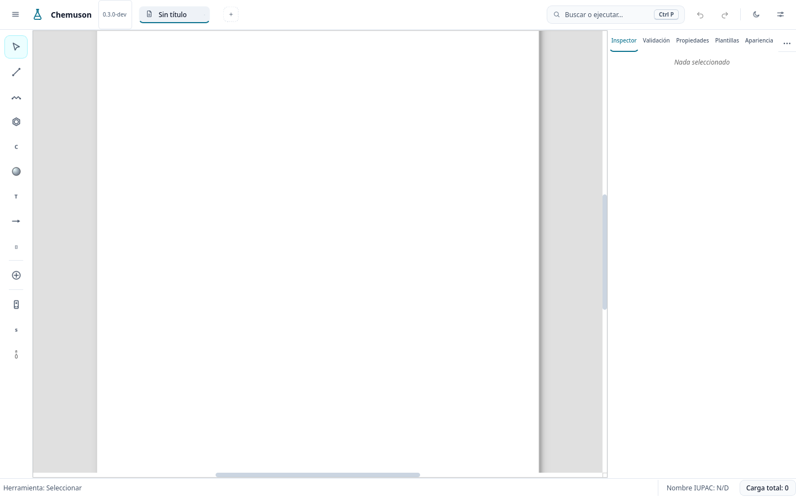
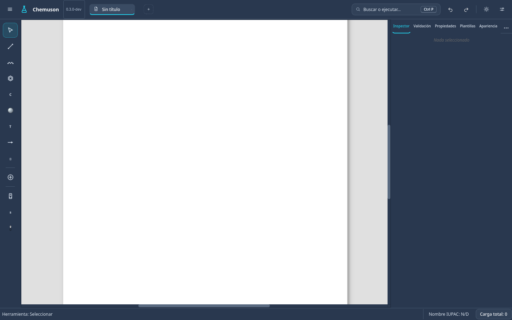

# ChemUSON

**An open-source molecular editor for chemistry education and research.**<br>
Developed by the **Supramolecular Chemistry Group at the University of Sonora, Mexico**.

**Language:** [Español (página principal)](README.md) · English

<p align="center"></p>
<p align="center"><sub>Visual identity of the ChemUSON project; it is not an official University of Sonora seal.</sub></p>

ChemUSON is an open-source desktop application to **draw, visualize, analyze and communicate chemical structures**. It combines a 2D editor, a molecular 3D viewer, and supporting tools for computational chemistry, nomenclature and scientific figures.

> **RECOMMENDED DOWNLOAD — [ChemUSON 0.3.0-beta.4](https://github.com/PJGV333/Chemuson/releases/tag/v0.3.0-beta.4)** (October 27, 2026). This is the **newest public release and the recommended version to evaluate ChemUSON** on Windows and Linux. Packages have passed automated checks, but not exhaustive manual acceptance testing on every platform. This is still a **beta**: bugs and incomplete functions may remain. Back up your work and independently verify scientific results.
>
> **Why is it labeled “Latest” although it is a beta?** At the owner's decision, beta.4 is the featured public download on GitHub. GitHub's `Latest` badge and `prerelease=false` metadata **do not make it a stable release**: its SemVer version remains `0.3.0-beta.4`. The release workflow may initially mark future betas as prereleases; GitHub's badge does not change SemVer precedence or the updater's policy.
>
> For **the exact source of beta.4**, use [its tag](https://github.com/PJGV333/Chemuson/tree/v0.3.0-beta.4). `main` is the active development branch and may advance beyond the published release. [Beta.3 remains available in the release history](https://github.com/PJGV333/Chemuson/releases/tag/v0.3.0-beta.3).

## Download ChemUSON 0.3.0-beta.4 — recommended

| Platform | Package | Official download |
| --- | --- | --- |
| Windows (64-bit) | Installer | [Download `.exe`](https://github.com/PJGV333/Chemuson/releases/download/v0.3.0-beta.4/Chemuson-v0.3.0-beta.4-windows-x86_64-setup.exe) |
| Windows (64-bit) | Portable application | [Download `.exe`](https://github.com/PJGV333/Chemuson/releases/download/v0.3.0-beta.4/Chemuson-v0.3.0-beta.4-windows-x86_64-portable.exe) |
| Linux (64-bit) | AppImage Type 2 | [Download `.AppImage`](https://github.com/PJGV333/Chemuson/releases/download/v0.3.0-beta.4/Chemuson-v0.3.0-beta.4-linux-x86_64.AppImage) |
| Linux (64-bit) | Flatpak | [Download `.flatpak`](https://github.com/PJGV333/Chemuson/releases/download/v0.3.0-beta.4/Chemuson-v0.3.0-beta.4-linux-x86_64.flatpak) |

Linux users can also [install through the published Flatpak beta channel](https://pjgv333.github.io/Chemuson/flatpak/beta/Chemuson-beta.flatpakref) to receive repository-based updates. A GitHub account is not needed to download public release files.

[**All release assets and notes**](https://github.com/PJGV333/Chemuson/releases/tag/v0.3.0-beta.4) · [**SHA-256 checksums**](https://github.com/PJGV333/Chemuson/releases/download/v0.3.0-beta.4/checksums.txt)

### Quick installation

**Windows:** run the downloaded installer, or start the portable executable without installing it.

**Linux AppImage:** grant execute permission and run:

```bash
chmod +x Chemuson-v0.3.0-beta.4-linux-x86_64.AppImage
./Chemuson-v0.3.0-beta.4-linux-x86_64.AppImage
```

**Linux Flatpak:** install from the official beta repository:

```bash
flatpak install --user https://pjgv333.github.io/Chemuson/flatpak/beta/Chemuson-beta.flatpakref
flatpak run io.github.PJGV333.Chemuson
```

The detailed [user manual is currently maintained in Spanish](docs/MANUAL_USUARIO.md).

## Features

- **2D molecular editing:** draw atoms, bonds, rings, chains, annotations, arrows and stereochemical bond styles.
- **Clean2D layout:** rearrange chemical diagrams for teaching, reports and scientific figures.
- **3D molecular visualization:** generate conformers, explore molecular geometry and use RDKit-powered molecular mechanics tools.
- **Chemical analysis:** inspect formula, molecular mass, exact mass, elemental analysis and available descriptors.
- **Nomenclature:** use a partial **IUPAC-lite** name generator and supported name-to-structure workflows.
- **Scientific illustration:** create energy diagrams, orbital representations and supporting lab annotations.
- **Import and export:** save editable `.cmsn` documents, handle compatible SMILES/Molfile structures and export PNG, SVG or PDF figures.
- **Work recovery:** autosave and session recovery mechanisms.

Some advanced capabilities depend on the input, chemical system, operating system and optional software.

## Screenshots

These are **reference images of a previous UI modernization stage**; some details may differ in the published beta.

| Light theme | Dark theme |
| --- | --- |
|  |  |

[More interface screenshots](docs/ui-modernization/after/README.md).

## Getting started

1. Start ChemUSON and choose **Archivo → Nuevo** (File → New).
2. Choose an atom, bond or ring tool from the left-hand toolbar.
3. Draw a molecule on the canvas; use **Seleccionar** (Select) to edit or move parts.
4. Use **Limpiar 2D** (`Ctrl+K`) when a cleaner diagram is needed.
5. Open the 3D viewer to examine the geometry of a supported molecule.
6. Save your work (`Ctrl+S`) as a `.cmsn` document or export an image.

**Guides:** [User manual (Spanish)](docs/MANUAL_USUARIO.md) · [ChemName nomenclature](docs/chemname.md) · [3D computational chemistry](docs/geometry3d_compchem.md).

## Scope and limitations

ChemUSON is under active development. Its IUPAC-lite engine **does not implement full IUPAC nomenclature**. Some advanced fused structures, coordination systems and stereochemistry may not be supported. Available spectrum predictions are heuristic, not substitutes for experimental measurements. Independently verify results before using them in consequential scientific work.

This beta is not a regulatory validation tool or a guarantee of error-free operation. To report a reproducible problem, [open an issue](https://github.com/PJGV333/Chemuson/issues) with the software version, operating system and reproduction steps, without disclosing private or confidential information.

## Technology

- **Desktop GUI:** Python and PyQt6.
- **Chemistry:** isolated RDKit workers, optional Open Babel, and internal validation and geometry tools.
- **Distribution:** Windows installer and portable executable; Linux AppImage Type 2 and Flatpak.

Technical details are maintained in the [architecture documentation](docs/architecture.md), [distribution plans](docs/distribution-plan.md) and [preview build guide](docs/release/PREVIEW_BUILDS.md).

### For developers

Use Python 3.10 or newer and a virtual environment:

```bash
python -m venv .venv
source .venv/bin/activate
python -m pip install -e .
python -m pip install -r requirements-dev.txt
```

On Windows activate `.venv\Scripts\activate`; with fish use `source .venv/bin/activate.fish`. For a given binary package, the version tag identifies the corresponding source.

## Origins and authors

ChemUSON originates from the **Supramolecular Chemistry Group, University of Sonora (Mexico)**. The project seeks to make molecular representation and analysis more accessible for chemical education, research and communication, while retaining the central role of scientific judgment.

**Authors:** Pedro Jancarlo Gomez Vega*, José Octavio Juárez Sánchez, Alondra Karolina Montaño Preciado, Ramón Moreno Corral, Felipe Medrano Valenzuela, David Octavio Corona Martínez, Karen L. Ochoa Lara*, and Jesús David Albino-Espíndola.

\* Corresponding authors.

**License:** [AGPL-3.0](LICENSE). Bug reports, feedback and contributions are welcome through [Issues](https://github.com/PJGV333/Chemuson/issues) and [Pull Requests](https://github.com/PJGV333/Chemuson/pulls).

---

**ChemUSON — University of Sonora, Mexico.** · [Versión en español](README.md)
