# Manual de usuario de ChemUSON

**Aplicación:** ChemUSON · **Idioma:** español<br>
**Versión pública de referencia:** [0.3.0-beta.4](https://github.com/PJGV333/Chemuson/releases/tag/v0.3.0-beta.4)<br>
**Revisión del manual:** 28 de octubre de 2026<br>
**Base funcional:** código del tag [`v0.3.0-beta.4`](https://github.com/PJGV333/Chemuson/tree/v0.3.0-beta.4) comprobado ejecutando la propia aplicación (interfaz, menús, atajos y herramientas) y capturas tomadas de esa ejecución.

<p align="center"></p>
<p align="center"><sub>Identidad visual del proyecto ChemUSON; no es un escudo institucional oficial.</sub></p>

> **ChemUSON es una aplicación libre para representar y analizar estructuras moleculares** en docencia e investigación. La versión 0.3.0-beta.4 es **experimental**: guarde copias de sus documentos importantes y verifique los resultados químicos antes de usarlos en un trabajo científico.

Este manual describe **solo las funciones disponibles en 0.3.0-beta.4**. Todo lo que no ha podido comprobarse en esa versión se indica de forma expresa o no se menciona.

[**Descargas oficiales**](https://github.com/PJGV333/Chemuson/releases/tag/v0.3.0-beta.4) · [**Página principal en español**](../README.md) · [**English overview**](../README.en.md)

---

## Contenido

1. [Instalación y primera apertura](#1-instalación-y-primera-apertura)
2. [La ventana de ChemUSON](#2-la-ventana-de-chemuson)
3. [Primer dibujo: flujo básico](#3-primer-dibujo-flujo-básico)
4. [Menús de la aplicación](#4-menús-de-la-aplicación)
5. [Rail de herramientas: átomos, enlaces, cadenas y anillos](#5-rail-de-herramientas-átomos-enlaces-cadenas-y-anillos)
6. [Rotación y reorientación de estructuras](#6-rotación-y-reorientación-de-estructuras)
7. [Texto, corchetes, flechas y símbolos](#7-texto-corchetes-flechas-y-símbolos)
8. [Diagramas de energía y orbitales](#8-diagramas-de-energía-y-orbitales)
9. [Placas TLC y geles de electroforesis](#9-placas-tlc-y-geles-de-electroforesis)
10. [Selección, transformación y navegación](#10-selección-transformación-y-navegación)
11. [Menú contextual](#11-menú-contextual)
12. [Paneles laterales](#12-paneles-laterales)
13. [Plantillas](#13-plantillas)
14. [Análisis químico, nomenclatura y validación](#14-análisis-químico-nomenclatura-y-validación)
15. [Química computacional 3D y asistente molecular](#15-química-computacional-3d-y-asistente-molecular)
16. [Archivos, formatos y exportación](#16-archivos-formatos-y-exportación)
17. [Guardado automático y recuperación](#17-guardado-automático-y-recuperación)
18. [Preferencias y actualizaciones](#18-preferencias-y-actualizaciones)
19. [Referencia de atajos](#19-referencia-de-atajos)
20. [Limitaciones conocidas](#20-limitaciones-conocidas)
21. [Solución de problemas](#21-solución-de-problemas)
22. [Identidad, licencia y procedencia de las ilustraciones](#22-identidad-licencia-y-procedencia-de-las-ilustraciones)

---

## 1. Instalación y primera apertura

La **versión pública más reciente es ChemUSON 0.3.0-beta.4**. Es una versión preliminar, no una edición estable.

### 1.1 Dónde descargar

| Plataforma | Archivos publicados en la [release v0.3.0-beta.4](https://github.com/PJGV333/Chemuson/releases/tag/v0.3.0-beta.4) |
|---|---|
| Linux x86-64 | `Chemuson-v0.3.0-beta.4-linux-x86_64.AppImage` · `Chemuson-v0.3.0-beta.4-linux-x86_64.flatpak` · `Chemuson-beta.flatpakref` (canal beta para recibir actualizaciones) |
| Windows x86-64 | `Chemuson-v0.3.0-beta.4-windows-x86_64-setup.exe` (instalador) y `Chemuson-v0.3.0-beta.4-windows-x86_64-portable.exe` (sin instalación) |

Cada release publica `checksums.txt` y un `.sha256` por archivo. Antes de instalar, compruebe las sumas:

```bash
sha256sum --check checksums.txt
```

### 1.2 Ejecutar el AppImage en Linux

```bash
chmod +x Chemuson-v0.3.0-beta.4-linux-x86_64.AppImage
./Chemuson-v0.3.0-beta.4-linux-x86_64.AppImage
```

En algunas distribuciones el arranque directo desde el gestor de archivos no está permitido por permisos; use el terminal o una herramienta de integración de AppImage.

### 1.3 Primera apertura

En la primera apertura aparece un **recorrido de bienvenida** de tres pasos —**Rail de herramientas**, **Lienzo** y **Panel lateral**— con botones **Anterior**, **Siguiente** y **Cerrar**. Al completarlo no vuelve a mostrarse; puede abrirlo cuando quiera desde **Ayuda → Guía rápida...**.

Si no se muestra ningún documento, cree uno con `Ctrl+N` (**Archivo → Nuevo**).

> **Nota sobre la barra de menús.** En una instalación nueva la barra de menús (`Archivo`, `Editar`, `Ver`, `Estructura`, `Reacción`, `Ayuda`) está visible. Si usted la oculta, podrá volver a mostrarla con **Ver → Mostrar barra de herramientas** o con el botón de menú de la barra superior.

---

## 2. La ventana de ChemUSON

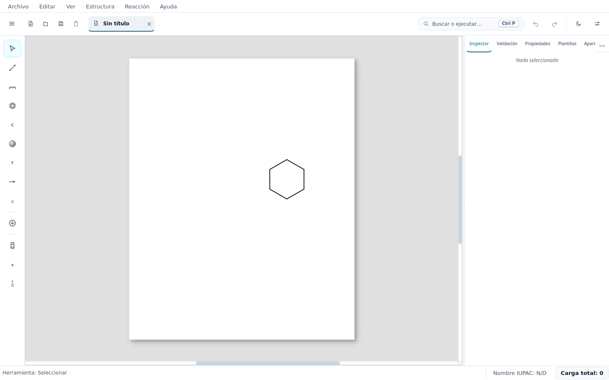

*Figura 1. Ventana principal de ChemUSON 0.3.0-beta.4 en tema claro, con un anillo de seis carbonos recién dibujado y el panel lateral en la pestaña **Inspector**. La barra superior muestra el documento «Sin título», el buscador «Buscar o ejecutar…» y los botones de deshacer/rehacer, tema y preferencias.*

La interfaz se organiza en seis zonas:

| Zona | Qué contiene |
|---|---|
| **Barra de menús** | `Archivo`, `Editar`, `Ver`, `Estructura`, `Reacción`, `Ayuda`. |
| **Barra de aplicación** | Menú hamburguesa, acciones rápidas de documento, pestañas de documento abierto, buscador de comandos, deshacer/rehacer, cambio de tema y preferencias. |
| **Rail de herramientas** (izquierda) | 13 botones de dibujo vertical, de 58 px de ancho. |
| **Lienzo** (centro) | Superficie de dibujo con las medidas del papel y sus reglas. |
| **Panel lateral** (derecha) | Siete vistas organizadas en pestañas: **Inspector**, **Validación**, **Propiedades**, **Plantillas**, **Apariencia** y, tras el botón `…` (*Más paneles*), **Espectroscopía** y **CompChem**. |
| **Barra de estado** (pie) | Herramienta activa, nombre IUPAC estimado y carga total del documento. |

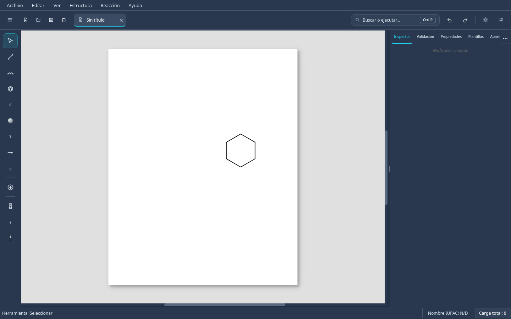

*Figura 2. La misma ventana en tema oscuro. El tema se cambia con el botón de media luna de la barra superior.*

### 2.1 Rail de herramientas

El rail reúne todas las herramientas de dibujo. Cada botón tiene dos comportamientos:

- **Clic izquierdo:** activa la variante que estaba seleccionada por última vez en esa categoría.
- **Segundo clic sobre la misma categoría, o clic derecho:** abre el **menú desplegable** (*flyout*) con todas las variantes de esa categoría.

Atajos de una sola tecla (sin modificadores, con el lienzo enfocado): `V` seleccionar, `B` enlaces, `L` cadena, `R` anillos, `C` átomos, `T` texto, `N` flechas, `G` corchetes, `E` diagramas de energía, `O` orbitales. Las categorías **Coordinación**, **Símbolos** y **Placas** no tienen atajo de tecla.

### 2.2 Paleta de comandos

El buscador «Buscar o ejecutar…» (`Ctrl+P`) encuentra acciones por nombre, incluidas las que no están en el rail o en los menús. Es la forma más rápida de localizar un comando sin recordar su ruta.

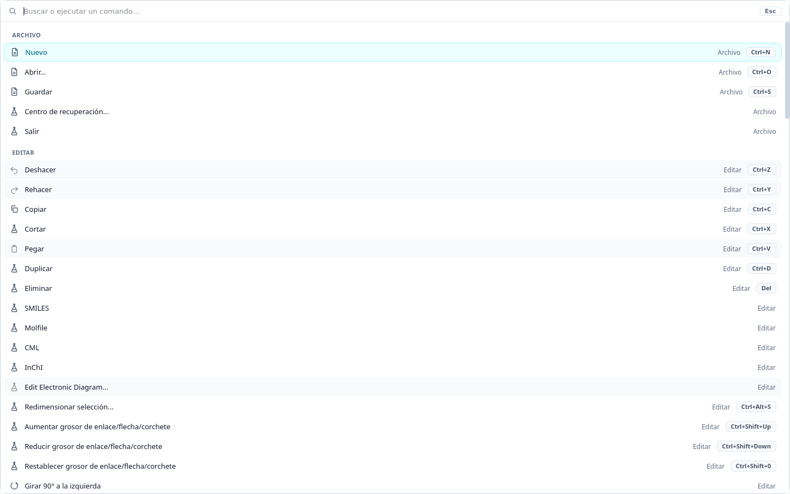

*Figura 3. Paleta de comandos abierta con `Ctrl+P`. Escriba una palabra (por ejemplo «limpiar», «plantilla» o «numerar») y pulse `Enter` para ejecutar la acción.*

### 2.3 Cómo leer las herramientas de una categoría

En todas las paletas del rail se aplica la misma mecánica:

1. Abra la categoría con segundo clic o clic derecho sobre su botón.
2. Pulse la celda deseada: esa pasa a ser la variante activa de la categoría y la herramienta queda seleccionada.
3. Dibuje en el lienzo con un clic o un arrastre, según la herramienta.
4. Pulse `Esc` para cancelar una operación a medias.

En la barra de estado se indica siempre la herramienta activa.

---

## 3. Primer dibujo: flujo básico

El ejercicio siguiente muestra el ciclo completo de trabajo con una molécula pequeña, el **1-propanol**.

1. **Cree un documento** con `Ctrl+N`.
2. **Dibuje tres carbonos consecutivos.** Con **Enlaces** activa (`B`), arrastre desde un punto vacío para crear el primer enlace entre dos carbonos. Arrastre desde uno de sus extremos para añadir un tercer carbono. Compruebe que hay tres carbonos en cadena.
3. **Añada el oxígeno sin sustituir un carbono.** Arrastre otro enlace desde un carbono terminal hacia un punto vacío: se crea un nuevo átomo. Active la categoría **Átomos** del rail (`C`), seleccione `O` en su paleta y haga clic en el nuevo átomo para convertirlo en oxígeno. También puede introducir el símbolo mediante el diálogo **Elemento** (véase [5.5](#55-herramienta-átomos)). La estructura es **CH₃–CH₂–CH₂–OH**.
4. **Limpie el dibujo.** Pulse `Ctrl+K` (**Estructura → Limpiar 2D (1 paso)**). Véase [Limpieza 2D](#441-limpieza-y-conformación-2d).
5. **Compruebe la química.** Ejecute **Estructura → Análisis → Fórmula química** y verifique que sea **C₃H₈O**. Confirme también que el grupo hidroxilo está unido a un carbono terminal. El resultado se escribe como texto en el lienzo; use **Ver → Paneles → Validación** para revisar valencias (véase [Análisis químico](#14-análisis-químico-nomenclatura-y-validación)).
6. **Guarde.** `Ctrl+S` guarda en el formato propio `.cmsn`, que conserva todos los objetos del documento.

> **Si un átomo queda con valencia incorrecta**, el panel **Validación** lo lista y permite saltar a él con `F8`.

---

## 4. Menús de la aplicación

### 4.1 Archivo

| Comando | Atajo | Qué hace |
|---|---|---|
| **Nuevo** | `Ctrl+N` | Crea un documento vacío en una pestaña nueva. |
| **Abrir...** | `Ctrl+O` | Abre uno o varios documentos (`.cmsn`, `.mol`, `.cml`). |
| **Guardar** | `Ctrl+S` o `Ctrl+G` | Guarda el documento activo en su propio archivo; si es nuevo, pregunta nombre y formato. |
| **Archivos recientes** | — | Lista los últimos documentos abiertos. |
| **Centro de recuperación...** | — | Abre el gestor de respaldos automáticos. |
| **Exportar como → PNG... / SVG... / PDF... / CML... / Estructura molecular (MOL)...** | — | Genera una copia del dibujo o de la estructura en ese formato. |
| **Salir** | — | Cierra la aplicación (la entrada no muestra atajo en pantalla). |

Al guardar se ofrecen **ChemUSON (`.cmsn`)** y **CML (`.cml`)**. El formato propio `.cmsn` es el único que conserva íntegros los objetos gráficos del documento; véase [Archivos y formatos](#16-archivos-formatos-y-exportación).

### 4.2 Editar

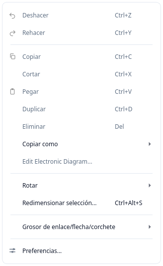

*Figura 4. Menú **Editar** de ChemUSON 0.3.0-beta.4, con el submenú **Copiar como** y la entrada **Rotar**.*

| Comando | Atajo | Qué hace |
|---|---|---|
| **Deshacer / Rehacer** | `Ctrl+Z` / `Ctrl+Y` | Deshace y rehace operaciones. Casi todas las acciones de dibujo son deshacibles. |
| **Copiar / Cortar / Pegar** | `Ctrl+C` / `Ctrl+X` / `Ctrl+V` | Trabajan con la selección. |
| **Duplicar** | `Ctrl+D` | Copia la selección desplazándola. |
| **Eliminar** | `Supr` | Borra la selección. |
| **Copiar como → SMILES / Molfile / CML / InChI** | — | Copia la estructura seleccionada al portapapeles en ese formato. SMILES, Molfile e InChI requieren RDKit. |
| **Edit Electronic Diagram…** | — | Abre el constructor del diagrama electrónico seleccionado. Disponible solo con ese tipo de objeto seleccionado. |
| **Rotar →** | (los de la tabla) | Girar y voltear la estructura, girar ramas y trabajar con fragmentos: véase [Rotación y reorientación](#6-rotación-y-reorientación-de-estructuras). |
| **Redimensionar selección...** | `Ctrl+Alt+S` | Ajusta el tamaño de la selección con valores numéricos. |
| **Grosor de enlace/flecha/corchete** | `Ctrl+Shift+↑` / `Ctrl+Shift+↓` / `Ctrl+Shift+0` | Aumenta, reduce o restablece el grosor de los trazos seleccionados. |
| **Preferencias...** | — | Abre el diálogo de preferencias. |

> **Sobre **Pegar**.** En 0.3.0-beta.4 la entrada aparece una sola vez en el menú. El portapapeles admite selecciones propias, Molfile, texto SMILES e imágenes (PNG, JPG, SVG).

### 4.3 Ver

| Comando | Función |
|---|---|
| **Mostrar barra de herramientas** | Muestra u oculta la barra de menús de la ventana. |
| **Visualización → Mostrar carbonos / Mostrar hidrógenos / Aromáticos como círculos / Dimensiones del dibujo... / Reglas / Cuadrícula** | Cambia cómo se representa la estructura. Con «Mostrar carbonos» desactivado, los vértices sin etiqueta se interpretan como carbono; es el modo habitual en química orgánica. «Dimensiones del dibujo…» fija la longitud de enlace y otros tamaños. |
| **Zoom → Zoom + / Zoom - / Zoom 100%** | `Ctrl++`, `Ctrl+-`, `Ctrl+0`. |
| **Numeración** | Submenú con **Mostrar numeración**, **Numerar átomos** (activado por defecto), **Numerar estructuras**, **Numerar ambos**, **Recalcular numeración** e **Incluir numeración en exportación**. |
| **Tamaño de lienzo** | Carta, A4 y A3 en vertical y horizontal, y **Personalizado...**. |
| **Paletas → Simbolismos químicos** | Muestra u oculta la barra flotante de simbología. |
| **Visor molecular 3D** | Activa el panel independiente de visualización tridimensional. |
| **Paneles** | Abre el panel lateral y salta a cada una de sus vistas: **Panel lateral**, **Inspector**, **Validación**, **Propiedades químicas**, **Plantillas**, **Apariencia**, **Espectroscopía**, **CompChem**. |

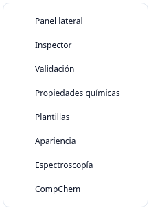

*Figura 5. **Ver → Paneles** en 0.3.0-beta.4. Las siete vistas del panel lateral se activan desde aquí; **Panel lateral** muestra u oculta el panel completo.*

**Zoom y navegación:** la rueda del ratón acerca y aleja; `Shift` + rueda desplaza horizontalmente; el botón central (o `Espacio` + arrastre) desplaza el lienzo.

### 4.4 Estructura

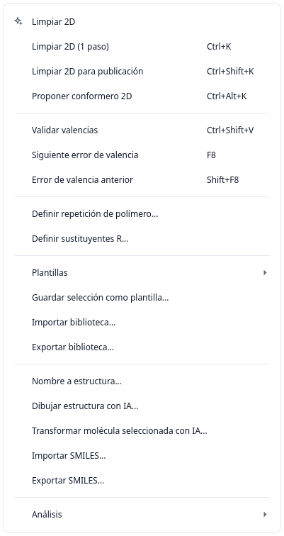

*Figura 6. Menú **Estructura** de ChemUSON 0.3.0-beta.4 tal como aparece en la versión publicada: limpieza 2D, validación de valencias, polímeros y grupos R, plantillas, conversiones de nombre y SMILES, y el submenú **Análisis**.*

#### 4.4.1 Limpieza y conformación 2D

| Comando | Atajo | Recomendación |
|---|---|---|
| **Limpiar 2D (1 paso)** | **`Ctrl+K`** | **Método recomendado para el trabajo diario.** |
| **Limpiar 2D para publicación** | `Ctrl+Shift+K` | Alternativa para una figura definitiva de manuscrito o póster. |
| **Proponer conformero 2D** | `Ctrl+Alt+K` | Alternativa cuando se quiere otra disposición del mismo dibujo. |
| **Limpiar 2D** | — | Entrada heredada, sin atajo: equivale a «Limpiar 2D (1 paso)». |

**Cómo usar `Ctrl+K`.** Sitúese sobre el dibujo (o seleccione antes la parte que desea ordenar) y pulse `Ctrl+K`. ChemUSON ajusta las coordenadas del dibujo —longitudes de enlace uniformes, ángulos habituales y anillos regulares— **sin cambiar la química**: el orden de los enlaces, las cargas y la conectividad se conservan. El resultado aparece en la barra de estado y se puede deshacer con un solo `Ctrl+Z`.

Qué esperar:

- Si hay una **selección**, solo se limpia esa estructura; si no hay selección, se limpia todo el documento.
- La longitud de enlace objetivo es la del documento (por defecto 42 px; se cambia en **Ver → Visualización → Dimensiones del dibujo…**).
- Si el dibujo ya estaba ordenado, la barra de estado lo indica y no se producen cambios apreciables.
- Las estructuras muy complejas se protegen: ChemUSON puede decidir no redibujarlas para no estropearlas.

**Cuándo usar cada alternativa.**

- `Ctrl+K` es suficiente mientras dibuja: es rápido y conserva una disposición reconocible.
- `Ctrl+Shift+K` realiza una limpieza más exigente, con más iteraciones y mayor peso en regularidad y ausencia de solapamientos. Úselo al preparar la figura final.
- `Ctrl+Alt+K` propone otra geometría válida para la misma estructura, cuando la primera disposición no es clara (cadenas cruzadas, anillos mal colocados). La propuesta sustituye la geometría y también es deshacible.
- **`Limpiar 2D`** (sin atajo) es una entrada de compatibilidad: en 0.3.0-beta.4 produce exactamente el mismo resultado que `Ctrl+K`. No aporta una ruta distinta y se prevé revisarla en versiones futuras.

#### 4.4.2 Validación de valencias

| Comando | Atajo | Función |
|---|---|---|
| **Validar valencias** | `Ctrl+Shift+V` | Analiza el documento y rellena el panel **Validación**. |
| **Siguiente error de valencia** | `F8` | Salta al siguiente problema y lo selecciona en el lienzo. |
| **Error de valencia anterior** | `Shift+F8` | Retrocede. |

El análisis suma las valencias observadas de cada átomo (órdenes de enlace, hidrógenos asignados e hidrógenos implícitos) y se muestra en la columna **Valencia** del panel. Cuando existe una corrección segura definida, el panel ofrece el selector y el botón **Aplicar corrección**; si no la hay, solo informa. Véase [Panel Validación](#12-paneles-laterales).

#### 4.4.3 Polímeros y grupos R

- **Definir repetición de polímero...**: asigna la etiqueta de repetición a los corchetes de una selección compatible.
- **Definir sustituyentes R...**: configura la información de los grupos R.

#### 4.4.4 Plantillas

El submenú **Plantillas** lista la biblioteca por categorías y ofrece **Guardar selección como plantilla...**, **Nueva categoría...**, **Importar biblioteca...** y **Exportar biblioteca...**. Todo el procedimiento se explica una sola vez en [Plantillas](#13-plantillas).

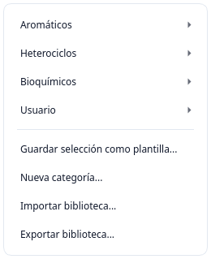

*Figura 7. **Estructura → Plantillas** en 0.3.0-beta.4: categorías con sus plantillas y las acciones de biblioteca.*

#### 4.4.5 Conversión y notaciones

| Comando | Qué hace |
|---|---|
| **Nombre a estructura...** | Convierte un nombre químico escrito por usted en una estructura. Consulta una tabla interna y, **si hay conexión a Internet, también PubChem** (véase la advertencia en [Análisis químico](#14-análisis-químico-nomenclatura-y-validación)). |
| **Dibujar estructura con IA...** | Abre el Asistente molecular. Función **experimental** que requiere configurar un modelo: véase [Asistente molecular](#153-asistente-molecular-experimental). |
| **Transformar molécula seleccionada con IA...** | Pide al asistente una transformación de una molécula seleccionada. También **experimental**. |
| **Importar SMILES...** | Escribe un SMILES en un cuadro de diálogo y construye la estructura en el lienzo. |
| **Exportar SMILES...** | **Copia el SMILES al portapapeles** y lo muestra en un aviso; no crea un archivo. |

#### 4.4.6 Análisis

El submenú **Análisis** contiene **Nombre (SMILES)**, **Fórmula química**, **Masa exacta**, **Peso molecular**, **m/z**, **Análisis elemental...** y **Todo**. El resultado **se inserta como texto en el lienzo**, bajo la estructura, y puede eliminarse con `Ctrl+Z`. La diferencia con el menú contextual se explica en [Menú contextual](#11-menú-contextual).

### 4.5 Reacción

En 0.3.0-beta.4 el menú **Reacción** contiene una única entrada, **Próximamente**, desactivada. No ofrece todavía herramientas de mapas de reacción.

### 4.6 Ayuda

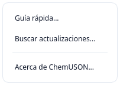

*Figura 8. Menú **Ayuda** en 0.3.0-beta.4: **Guía rápida...**, **Buscar actualizaciones...** y **Acerca de ChemUSON...**.*

| Comando | Función |
|---|---|
| **Guía rápida...** | Abre el recorrido de bienvenida de tres pasos (rail, lienzo y panel lateral). |
| **Buscar actualizaciones...** | Comprueba si hay una versión nueva del programa. Cómo se aplica depende del tipo de instalación ([18.3](#183-buscar-actualizaciones)). |
| **Acerca de ChemUSON...** | Muestra la versión instalada y los créditos. |

### Manual de usuario en línea

Este documento es el **manual de usuario de ChemUSON**. Léalo en GitHub en:

> **<https://github.com/PJGV333/Chemuson/blob/main/docs/MANUAL_USUARIO.md>**

Puede consultarlo también desde el repositorio, en la ruta `docs/MANUAL_USUARIO.md`, o descargarlo desde la página de la release.

> **Nota honesta sobre esta sección.** En 0.3.0-beta.4 el menú **Ayuda** **no** incluye ninguna entrada que abra el manual. No existe un «Ayuda → Manual de usuario» en la interfaz. La entrada del menú es una **propuesta de mejora** registrada para una versión futura; mientras tanto, use el enlace anterior.

---

## 5. Rail de herramientas: átomos, enlaces, cadenas y anillos

Las cinco primeras categorías del rail sirven para construir el esqueleto de la molécula: **Seleccionar**, **Enlaces**, **Cadena**, **Anillos**, **Átomos** y **Coordinación**. En todas ellas, un clic activa la variante seleccionada por última vez; un segundo clic o un clic derecho abre la paleta de variantes.

### 5.1 Herramienta Seleccionar

Abre la paleta con segundo clic sobre el botón: contiene **Seleccionar**, **Seleccion libre** y la variante de rotación tridimensional descrita en [Rotación y reorientación](#6-rotación-y-reorientación-de-estructuras).

- **Seleccionar** (`V`): clic para seleccionar un objeto; `Shift` + clic suma o quita objetos; arrastre sobre zona vacía para seleccionar con un marco rectangular.
- **Seleccion libre**: arrastre trazando un recorrido cerrado; quedan dentro todos los objetos encerrados.

Detalles de selección, movimiento y alineación: [Selección, transformación y navegación](#10-selección-transformación-y-navegación).

### 5.2 Herramienta Enlaces

La paleta tiene once variantes: **Enlace sencillo (incremental)**, **Enlace grueso (bold)**, **Enlace doble**, **Enlace triple**, **Enlace aromático**, **Wedge**, **Wedge hashed**, **Wavy**, **Enlace flexible (curvo)**, **Enlace intermolecular** y **Enlace coordinativo**.

**Cómo dibujar.** Con la herramienta activa (`B`):

| Gestos | Resultado |
|---|---|
| Arrastrar desde una zona vacía | Crea un átomo nuevo en cada extremo y un enlace entre ellos. |
| Arrastrar desde un átomo hacia una zona vacía | Añade un átomo nuevo unido al átomo de origen. |
| Arrastrar de un átomo a otro átomo | Crea el enlace entre esos dos átomos (o cambia el existente). |
| Soltar encima de un enlace ya dibujado, o simple clic sobre él | Con **Enlace sencillo (incremental)** aumenta el orden del enlace (sencillo → doble → triple → sencillo). Con cualquier otro estilo, aplica ese estilo al enlace. |
| Soltar cerca de otro átomo | El enlace se conecta automáticamente al átomo más cercano dentro del radio de captura. |

Las celdas **Wedge** y **Wedge hashed** se usan para indicar estereoquímica (enlace hacia delante / hacia detrás del plano); **Wavy** expresa estereoquímica indefinida; **Enlace flexible** permite curvar el trazo arrastrando el puntero durante el dibujo; **Enlace intermolecular** y **Enlace coordinativo** se emplean en complejos y puentes de hidrógeno.


*Figura 9. Órdenes de enlace creados con la herramienta **Enlaces**: sencillo, doble y triple. Cambiar el orden de un enlace existente se hace arrastrando el mismo estilo sobre él, o escribiendo la cifra 1, 2 o 3 con el puntero sobre el enlace.*


*Figura 10. Estilos de la paleta de **Enlaces** aplicados sobre una cadena: plano, grueso (*bold*), *wedge*, *wedge hashed*, *wavy* y flexible (curvo).*

### 5.3 Herramienta Cadena

Es un botón de un solo clic (`L`): no tiene paleta de variantes. Arrastre en el lienzo para trazar una sucesión de enlaces con ángulos normales. Para continuar una cadena existente, empiece el arrastre sobre un átomo.

**Atajo con cifras.** Con el puntero sobre un átomo, pulse `1`…`9`: se añade una cadena de esa longitud. Con `Shift` + `3`…`9` se dibuja directamente un anillo de ese tamaño (véase [Anillos](#54-herramienta-anillos)).

### 5.4 Herramienta Anillos

Once celdas: **Benceno** (aromático de seis) y **Anillo 3** a **Anillo 12**, además de la acción **Tamaño personalizado...**, que pide el número de vértices. Atajo `R`.

**Cómo dibujar.** Arrastre definiendo una arista del anillo: el punto de inicio y el de fin fijan el tamaño y la orientación. Si el arrastre comienza sobre un átomo, el anillo se **funde** con la estructura existente compartiendo ese átomo; si comienza sobre un enlace, comparte esa arista.

**Atajo con cifras.** Puntero sobre un átomo y `Shift` + `3`…`9` inserta directamente el anillo pedido.

### 5.5 Herramienta Átomos (selección de elemento)

**Nombre en la interfaz:** la categoría del rail se llama **Átomos** (atajo `C`), mientras que el botón puede mostrar el mensaje **Elemento C**, **Elemento N**, etc., según el símbolo activo. Al introducir un símbolo por teclado se abre el diálogo **Elemento**, con los campos «Símbolo del elemento o grupo funcional» y «Átomo de unión». Son dos nombres de partes de una misma función, no herramientas distintas.

La paleta tiene diez celdas rápidas —`C`, `N`, `O`, `S`, `P`, `F`, `Cl`, `Br`, `I`, `H`— y la acción **Tabla periódica...**, que abre el selector completo de elementos.

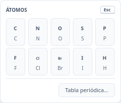

*Figura 11. Paleta **ÁTOMOS** del rail (segundo clic sobre el botón o tecla `C`). Las diez casillas son **elementos que se eligen con el ratón**, no atajos de teclado.*

**Cómo usarla (tres comportamientos, todos verificados en 0.3.0-beta.4):**

| Sobre qué hace clic | Qué ocurre |
|---|---|
| Zona vacía del lienzo | Crea un átomo del elemento elegido. |
| Un átomo ya dibujado | Cambia ese átomo al elemento elegido. |
| Un hidrógeno implícito mostrado sobre un átomo | Sustituye ese hidrógeno por el elemento elegido (el átomo pasa a ser ese elemento). |

Si prefiere teclear, active la categoría **Átomos** y escriba un símbolo (`C`, `Na`, `Ca`, `Br`…) con el foco en el lienzo. Cuando se abra el diálogo **Elemento**, confirme el símbolo y, si corresponde, el átomo de unión; la tecla `C` usada como atajo por sí sola **no inserta automáticamente un carbono**. Con **Seleccionar** también puede introducir el símbolo sobre un átomo seleccionado.

> **Aclaremos un malentendido habitual.** Las letras `C`, `N`, `O`, `S`, `P`, `Cl`, `Br`, `I` y `H` que se ven en la paleta **no son accesos directos de teclado**: son casillas que se pulsen con el ratón. Con el lienzo enfocado, la tecla `C` activa la herramienta **Átomos** y `N` activa **Flechas**; no introducen elementos. En 0.3.0-beta.4 no existe una función para elegir elementos con una sola tecla.

### 5.6 Herramienta Coordinación

Botón de un solo clic, sin atajo de tecla ni paleta de variantes. Sirve para trabajar complejos de coordinación:

- **Clic en una zona vacía:** crea un átomo marcado como **centro de coordinación**, con su esfera dibujada. El elemento utilizado es el que esté activo en la herramienta **Átomos**; si ese elemento es carbono, se usa **Pd**.
- **Clic sobre un átomo existente:** marca ese átomo como centro de coordinación y le añade la esfera, sin cambiar su elemento.

Dibuje después los enlaces metal–ligando con la herramienta **Enlaces** (**Enlace coordinativo** es una de sus variantes). La misma función está disponible en el menú contextual de un átomo, con **Activar esfera de coordinación** y el submenú **Estilo de esfera** ([capítulo 11](#11-menú-contextual)). Deshaga con `Ctrl+Z`.

---

## 6. Rotación y reorientación de estructuras

Quedan separadas tres cosas distintas que en ChemUSON tienen entradas propias: **girar el dibujo en el plano** (2D), **reorientar una parte de la molécula** (ramas y fragmentos) y **manipular la perspectiva tridimensional** de un dibujo plano. Ninguna de ellas sustituye al visor molecular 3D, que se trata en [Química computacional 3D](#151-visor-molecular-3d).

### 6.1 Girar y voltear la selección (2D)

Ruta: **Editar → Rotar**.

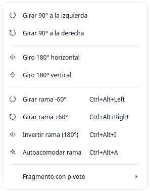

*Figura 12. **Editar → Rotar** en 0.3.0-beta.4. Los cuatro primeros comandos actúan sobre la selección; los siguientes sobre la rama bajo el puntero; el submenú **Fragmento con pivote** aparece atenuado si no hay un átomo pivote definido.*

| Comando | Atajo | Qué hace |
|---|---|---|
| **Girar 90° a la izquierda** | — | Rota la selección 90° en sentido antihorario. |
| **Girar 90° a la derecha** | — | Rota la selección 90° en sentido horario. |
| **Giro 180° horizontal** | — | Voltea la selección como en un espejo vertical. |
| **Giro 180° vertical** | — | Voltea la selección como en un espejo horizontal. |
| **Girar rama −60° / +60°** | `Ctrl+Alt+←` / `Ctrl+Alt+→` | Gira la rama que cuelga del enlace bajo el puntero. |
| **Invertir rama (180°)** | `Ctrl+Alt+I` | Intercambia las dos mitades de una rama. |
| **Autoacomodar rama** | `Ctrl+Alt+A` | Reubica la rama para evitar solapamientos. |

Las cuatro primeras entradas no tienen atajo asignado en la interfaz; puede localizarlas con la paleta de comandos (`Ctrl+P`). Si no hay nada seleccionado, los comandos de giro actúan sobre todo el documento.

Estas operaciones modifican coordenadas del dibujo, **no la conectividad ni la estereoquímica declarada**: si necesita cambiar la configuración de un centro estereogénico, use los estilos de enlace *wedge* / *wedge hashed* o el visor 3D.

### 6.2 Fragmento con pivote

Submenú **Editar → Rotar → Fragmento con pivote**, con **Definir átomo pivote desde selección** y los pasos de giro del fragmento alrededor de ese pivote.

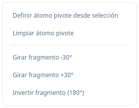

*Figura 13. **Editar → Rotar → Fragmento con pivote**. Las entradas de giro permanecen atenuadas hasta que se define un átomo pivote.*

**Procedimiento:**

1. Seleccione **un solo átomo** que deba actuar como pivote (normalmente el átomo por el que un fragmento se une al resto).
2. Ejecute **Editar → Rotar → Fragmento con pivote → Definir átomo pivote desde selección**.
3. Use las entradas de giro del mismo submenú para rotar el fragmento en pasos fijos alrededor de ese átomo.

Si la selección contiene más de un átomo o está vacía, la entrada **Definir átomo pivote desde selección** aparece atenuada, como se ve en la figura 13. El pivote deja de aplicarse al deshacer la operación o al cambiar de documento.

### 6.3 Rotación interactiva en el lienzo

Sin abrir ningún menú:

- **`Alt` + arrastre sobre la estructura:** gira la molécula siguiendo el movimiento del puntero. Es la forma más rápida de reorientar un dibujo.
- **`Alt+0`:** restablece la orientación original de la estructura afectada.

### 6.4 «Rotación 3D precisa» (perspectiva tridimensional de un dibujo plano)

En 0.3.0-beta.4 esta función **sí existe**, pero no es un menú independiente: es una variante de la herramienta **Seleccionar**. Ábrala con segundo clic (o clic derecho) sobre el botón **Seleccionar** del rail y elija **Rotación 3D precisa**.

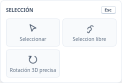

*Figura 14. Paleta **SELECCIÓN** del rail: **Seleccionar**, **Seleccion libre** y **Rotación 3D precisa**.*

Al activarla con una estructura seleccionada se abre el cuadro **Rotación 3D precisa**:

- Controles **Ángulo X** y **Ángulo Y**, con casillas para valor exacto y para el paso incremental.
- Cuatro flechas para girar en pasos y un botón **Restablecer**.
- **Vista previa en el propio lienzo**: el dibujo se proyecta con una simulación de pista de rodamiento (*trackball*) sobre la superficie 2D. Confirme para aplicar el giro; cancele con `Esc` o **Cancelar**.

**Qué es y qué no es.** La proyección sirve para obtener una perspectiva tridimensional **de un esquema plano** (p. ej. mostrar una molécula en oblicuo en una diapositiva). **No** es una rotación de un modelo tridimensional real: no cambia coordenadas `z` de los átomos ni la estereoquímica. Para trabajar una geometría tridimensional auténtica use el **Visor molecular 3D** o el panel **CompChem** ([capítulo 15](#15-química-computacional-3d-y-asistente-molecular)).

### 6.5 Comparación rápida

| Lo que quiere hacer | Use | Capítulo |
|---|---|---|
| Poner la molécula en otra posición del papel | **Editar → Rotar** o `Alt` + arrastre | 6.1, 6.3 |
| Enderezar un dibujo desordenado | **`Ctrl+K`** (Limpiar 2D) | [4.4.1](#441-limpieza-y-conformación-2d) |
| Rotar un sustituyente alrededor de un enlace | **Fragmento con pivote** | 6.2 |
| Ver la molécula en perspectiva sobre el papel | **Rotación 3D precisa** | 6.4 |
| Inspeccionar y manipular un modelo 3D | **Ver → Visor molecular 3D** | [15.1](#151-visor-molecular-3d) |

---

## 7. Texto, corchetes, flechas y símbolos

### 7.1 Texto y etiquetas

La herramienta **Texto** (`T`) abre una paleta con nueve controles: **Fuente de etiquetas…**, **Tamaño…**, **Negrita** (`Ctrl+B`), **Cursiva** (`Ctrl+I`), **Subrayado** (`Ctrl+U`), **Subíndice…** (`Ctrl+=`), **Superíndice…** (`Ctrl+Shift+=`), **Aumentar tamaño** y **Reducir tamaño**.

Al activar la herramienta **Texto** —o al seleccionar un objeto de texto ya creado— aparece además una **barra de formato de texto** bajo la barra superior. No es una barra fija: solo se muestra en contexto de texto. Ofrece:

| Control | Detalle |
|---|---|
| Cuadro de **fuente** | Lista de las fuentes instaladas en el sistema. |
| Cuadro de **tamaño** | De 6 a 144 pt. |
| **B**, **I**, **U** | Negrita, cursiva y subrayado (`Ctrl+B`, `Ctrl+I`, `Ctrl+U`). |
| **x₂** / **x²** | Subíndice (`Ctrl+=`) y superíndice (`Ctrl+Shift+=`). Son conmutables: activar uno desactiva el otro. |
| Alineación | **Alinear a la izquierda**, **Centrar**, **Justificar**. |
| **Color de texto** | Abre el selector de color. |
| **Op …%** | Opacidad de 0 a 100 % en pasos de 5. |

Los cambios se aplican **al texto que está escribiendo** y, si ya tiene objetos de texto seleccionados, **a esos objetos**; además quedan como formato por defecto para los textos siguientes. Todo es deshacible con `Ctrl+Z`.

**Cómo usarla:**

1. Elija la herramienta **Texto** y haga clic en el punto del lienzo donde empezar.
2. Escriba; pulse `Enter` para confirmar o `Esc` para descartar.
3. Para crear un subíndice o superíndice dentro de una misma etiqueta (por ejemplo, el «2» de «H₂O»), seleccione ese fragmento en la caja de edición y pulse **x₂** o **x²** en la barra de formato.

Los textos creados son objetos del documento: se seleccionan, mueven, copian y eliminan como cualquier otro, y puede editarlos de nuevo con doble clic.

**Color de las etiquetas de los átomos.** Desde la barra flotante de simbología (**Ver → Paletas → Simbolismos químicos**), el botón **Texto** incluye el submenú **Color de etiquetas ▸** con dos opciones excluyentes: **Por elemento** (por defecto: oxígeno en rojo, nitrógeno en azul, etc.) y **Negro**, útil para impresiones y publicaciones en blanco y negro. Afecta a todas las etiquetas de átomo del documento y es reversible.

> **Dos avisos.** `Ctrl++` está registrado a la vez por **Zoom +** y por el **superíndice**: en el lienzo gana el zoom, así que use `Ctrl+Shift+=` o la barra de formato. Y el cuadro **Op %** de la barra de formato **sin nada seleccionado afecta a todo el lienzo**; aplíquelo solo sobre la selección concreta.

### 7.2 Corchetes y marcos

La herramienta **Corchetes** (`G`) ofrece diez variantes: **Corchetes []**, **Corchete izquierdo [**, **Corchete derecho ]**, **Esquinas**, **Llaves {}**, **Llave izquierda {**, **Llave derecha }**, **Marco**, **Marco con esquinas redondeadas** y **Parentesis ()**.

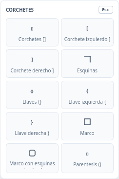

*Figura 15. Paleta **CORCHETES** del rail (tecla `G`).*

**Cómo dibujar:** mantenga pulsado y **arrastre** para definir el rectángulo que el corchete debe envolver; suelte para colocarlo. Un simple clic no dibuja nada: se necesita un arrastre de al menos unas pocas unidades. Si el corchete se usa para una repetición de polímero, selecciónelo y aplique **Estructura → Definir repetición de polímero...**.

La variante **Esquinas** coloca un único ángulo (arriba a la derecha), útil para marcar esquinas de un diagrama; si necesita las cuatro, use **Marco**.

### 7.3 Flechas y líneas

La herramienta **Flechas** (`N`) contiene dieciséis variantes, agrupadas en cuatro columnas:

| Familia | Variantes |
|---|---|
| Trazos | **Línea**, **Línea discontinua** |
| Flecha directa | **Flecha directa**, **Flecha directa abierta**, **Flecha directa discontinua** |
| Flecha «retro» | **Flecha retro**, **Flecha retro abierta**, **Flecha retro discontinua** |
| Flecha doble | **Flecha doble**, **Flecha doble abierta**, **Flecha doble discontinua** |
| Equilibrio y retrosíntesis | **Equilibrio**, **Equilibrio discontinuo**, **Flecha retrosíntesis** |
| Curvas de mecanismo | **Flecha curva**, **Flecha curva (1 e⁻)** |

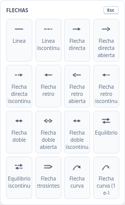

*Figura 16. Paleta **FLECHAS** del rail (tecla `N`), con sus dieciséis variantes.*

**Cómo dibujar:**

- **Dos clics** para las flechas y líneas rectas: el primero fija el origen, el segundo el extremo. Durante el recorrido puede mover el puntero para ajustar la dirección.
- **Tres clics** para las flechas curvas: origen, extremo y un tercer punto que define la curvatura.
- `Shift` mientras se dibuja restringe las líneas rectas a múltiplos de 45°; en las curvas invierte el signo de la curvatura.
- `Alt` desactiva el imán a los extremos de enlaces y átomos cuando quiere una posición libre.
- Con una flecha o una línea seleccionada, el menú contextual ofrece **Grosor de enlace/flecha/corchete ▸** y el submenú **Longitud de lineas ▸** (**Igualar longitudes** con dos o más líneas, **Establecer longitud...**). El grosor también se ajusta con `Ctrl+Shift+↑`, `Ctrl+Shift+↓` y `Ctrl+Shift+0` ([4.2](#42-editar)).

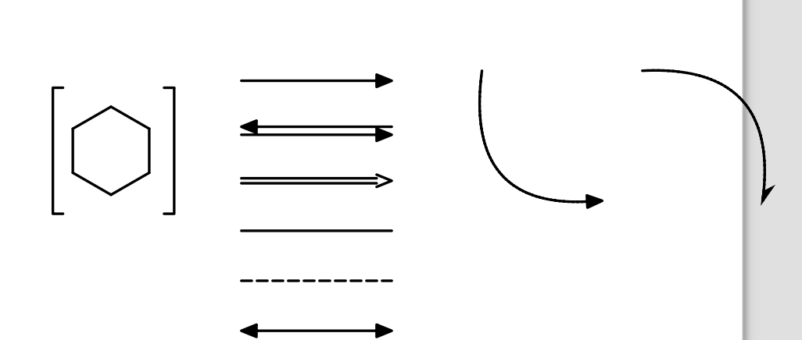

*Figura 17. Ejemplo de anotaciones sobre un ciclohexano: corchete **[ ]**, flecha directa, equilibrio, retrosíntesis, línea, línea discontinua, flecha doble y dos flechas curvas de mecanismo (la segunda, de un solo electrón).*

### 7.4 Símbolos químicos, cargas y electrones

La herramienta **Símbolos** (sin atajo de tecla) ofrece doce glifos: **Carga positiva**, **Carga negativa**, **Carga alterna (+/−)**, **Signo más**, **Signo menos**, **Electrón desapareado**, **Par solitario**, **Ancla ondulada**, **Radical catión**, **Radical anión**, **Carga parcial (δ+)** y **Carga parcial (δ−)**.

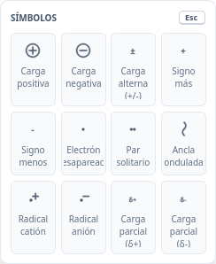

*Figura 18. Paleta **SÍMBOLOS** del rail.*

**Comportamiento verificado:**

- **Carga positiva** y **Carga negativa** modifican la **carga formal del átomo** bajo el puntero; el signo se coloca junto a él. Si no hay ningún átomo, no ocurre nada.
- **Par solitario** y **Electrón desapareado** solo se pueden colocar sobre átomos para los que la aplicación define pares de electrones: `N`, `O`, `S`, `P`, `F`, `Cl`, `Br`, `I`, `Se` y `B`. En cualquier otro átomo la aplicación no los inserta.
- **Carga parcial (δ+ / δ−)**, **Radical catión** y **Radical anión** son **anotaciones de texto**: no cambian la carga formal ni la fórmula del documento.
- **Signo más**, **Signo menos** y **Carga alterna** se insertan como glifo gráfico libre (útil para leyendas y ecuaciones).

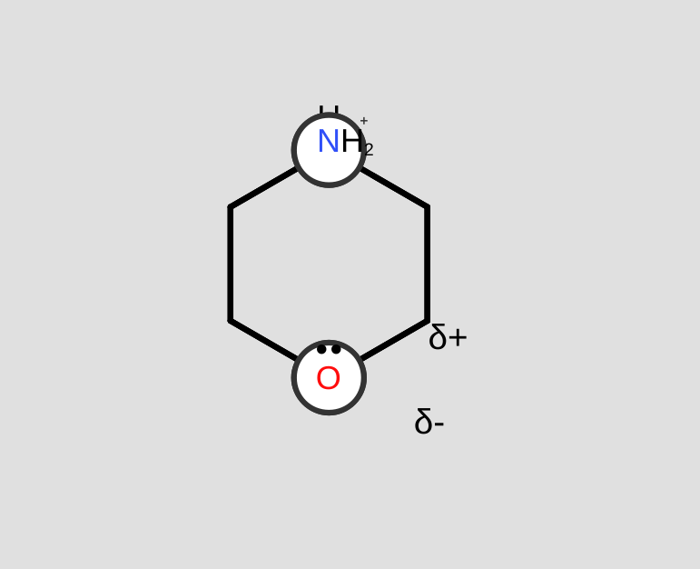

*Figura 19. Ejemplo con la herramienta **Símbolos**: nitrógeno con carga formal positiva, oxígeno con carga parcial negativa y dos pares de electrones, y carga parcial positiva sobre el hidrógeno unido al carbono.*

Para ajustar cargas sin glifos, use el menú contextual del átomo: **Carga formal → Incrementar (+1) / Disminuir (-1) / Establecer... / Restablecer a 0 / No implícitos** ([capítulo 11](#11-menú-contextual)).

### 7.5 Barra de simbología alternativa

**Ver → Paletas → Simbolismos químicos** muestra u oculta una barra adicional con las mismas categorías de dibujo del rail, agrupadas en un solo panel horizontal. Está **oculta por defecto**: el rail de la izquierda ya ofrece esas herramientas. Active esta barra si prefiere tener todas las variantes a la vista en lugar de abrirlas desde el rail; ambos controles comparten el estado, de modo que elegir una herramienta en la barra activa la misma que en el rail.

---

## 8. Diagramas de energía y orbitales

Ambas categorías del rail insertan objetos gráficos prediseñados que se pueden mover, escalar y editar. Son **esquemas didácticos**: no se calculan a partir de la estructura dibujada.

### 8.1 Diagramas de energía

La herramienta **Energía** (`E`) ofrece ocho preset en su paleta: **Subnivel s**, **Nivel personalizable**, **Subnivel p**, **Subnivel d**, **Subnivel f**, **Híbrido sp**, **Híbrido sp²** y **Híbrido sp³**.

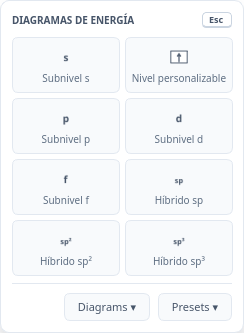

*Figura 20. Paleta **DIAGRAMAS DE ENERGÍA** del rail (tecla `E`). En la parte inferior aparecen dos submenúes adicionales: **Electronic Diagrams** y **Electronic Diagram Presets**.*

**Cómo insertar uno:** active la herramienta y haga **un solo clic** en el punto del lienzo donde desea colocarlo. El objeto se crea con sus niveles y etiquetas por defecto.

**Submenúes de la misma paleta.**

- **Electronic Diagrams** abre tres constructores: **Atomic diagram...** (niveles de un elemento), **Diatomic MO diagram...** (orbitales moleculares de una diatómica) y **Ligand field diagram...** (desdoblamiento del campo de ligandos). Los cuadros se muestran en inglés.
- **Electronic Diagram Presets** despliega **Atomic Presets**, **Diatomic MO Presets** y **Ligand Field Presets**, con modelos ya construidos listos para colocar en el lienzo. Todos los nombres de estos dos submenúes aparecen en inglés en la interfaz.

Al seleccionar un diagrama, el menú contextual ofrece el submenú **Diagrama de energia** (**Etiqueta...**, **Posición de etiqueta**, **Numero de cajas...**, **Ocupación electrónica...**, **Estilo**) y, en los diagramas electrónicos, el submenú **Diagrama electrónico** con **Edit Electronic Diagram...**, **Mostrar resumen inferior** y **Editar título...** ([11.6](#116-objeto-por-objeto)).

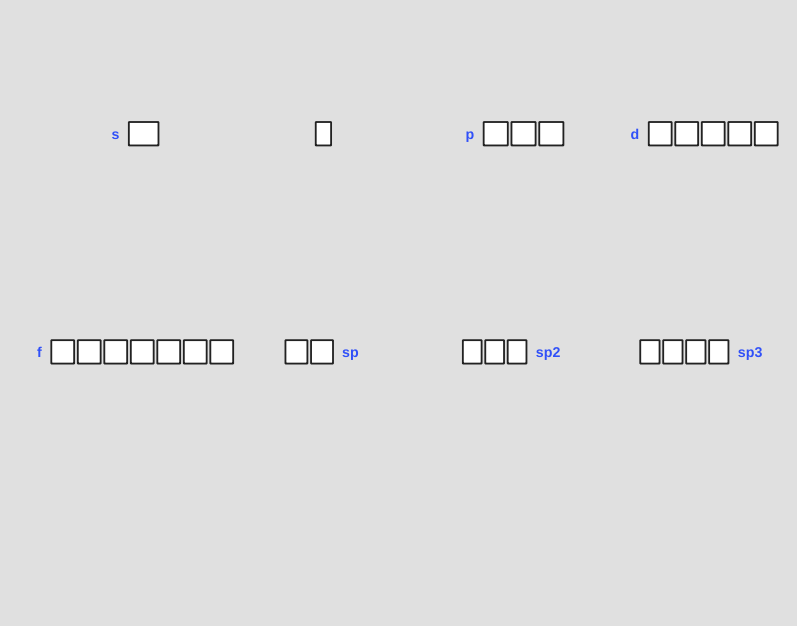

*Figura 21. Diagramas creados con la herramienta **Energía**: subniveles `s`, `p`, `d` y `f`, nivel personalizable e híbridos `sp`, `sp²` y `sp³`. Todos son editables y se pueden escalar con los tiradores de selección.*

### 8.2 Orbitales

La herramienta **Orbitales** (`O`) contiene veintitrés glifos, agrupados por tipo y por acabado (contorno, sombreado o sólido):

| Familia | Variantes |
|---|---|
| `s` | Orbital `s` (contorno), Orbital `s` (sombreado) |
| `p` | Orbital `p` (sombreado), Orbital `p` (sólido) |
| `d` | Orbital `d` (sombreado), Orbital `d` (sólido) |
| Toroide | Toroide (contorno), Toroide (sombreado), Toroide (sólido) |
| `sp³` | Orbital `sp³` (sombreado), Orbital `sp³` (sólido) |
| `dz²` | Orbital `dz²` (sombreado), Orbital `dz²` (sólido) |
| Lóbulo `sp` | Lóbulo `sp` (contorno), Lóbulo `sp` (sombreado), Lóbulo `sp` (sólido) |
| `σ` | Sigma enlazante (sombreado), Sigma enlazante (sólido) |
| `π` | Pi enlazante (sombreado), Pi enlazante (sólido) |
| `sp²` | Orbital `sp²` (contorno), Orbital `sp²` (sombreado), Orbital `sp²` (sólido) |

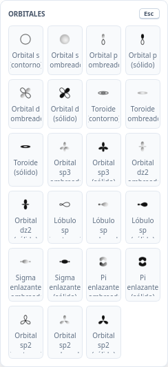

*Figura 22. Paleta **ORBITALES** del rail (tecla `O`). Los nombres son los que muestra la propia aplicación.*

**Cómo insertar uno:** active la herramienta y haga un clic en el lienzo. Al seleccionarlo puede escalarlo, rotarlo y, desde el menú contextual (**Orbital → Editar lóbulo**), ajustar sus lóbulos.

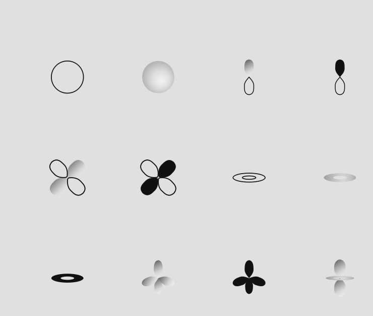

*Figura 23. Doce glifos de la paleta de **Orbitales**: `s` en contorno y sombreado, `p` sombreado y sólido, `d` sombreado y sólido, toroide en sus tres acabados, `sp³` sombreado y sólido y `dz²` sombreado.*

> **Qué no hay en esta paleta.** En 0.3.0-beta.4 no existen glifos de orbitales `f` en la herramienta **Orbitales** (los subniveles `f` solo están disponibles como **diagrama de energía**, sección 8.1) ni un orbital `sp` completo: lo más parecido es el **Lóbulo sp** de un solo lóbulo. No se ofrecen orbitales `π*` ni `δ`.

---

## 9. Placas TLC y geles de electroforesis

La herramienta **Placas** (sin atajo de tecla) ofrece dos objetos: **Placa TLC** y **Gel de Electroforesis**. Ambos son esquemas para ilustrar separaciones; los valores son los que usted introduzca, no resultados calculados.

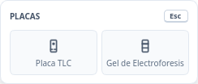

*Figura 24. Paleta **PLACAS** del rail: **Placa TLC** y **Gel de Electroforesis**.*

### 9.1 Colocar una placa o un gel

1. Abra la paleta **Placas** y elija el tipo.
2. Haga un clic en el lienzo: se abre un cuadro de configuración.
   - **Insertar Placa TLC** pide **Número de carriles** (de 1 a 20; por defecto 3).
   - **Insertar Gel Electroforesis** pide **Número de pocillos** (de 1 a 30; por defecto 5).
3. Acepte: la placa aparece con su línea de partida, su frente de disolvente y sus manchas o bandas ya situadas en el origen.

### 9.2 Editar manchas y bandas

Con el puntero sobre una mancha (o banda), abra el menú contextual:

| Entrada | Función |
|---|---|
| **Cambiar color…** | Elige el color de la mancha. |
| **Opacidad** | 20 %, 40 %, 60 %, 80 % u 100 %. |
| **Tamano** | **Pequena**, **Normal** o **Grande** (estas tres palabras aparecen sin tilde en la aplicación). |
| **Mostrar Rf / Ocultar Rf** | Muestra o esconde la etiqueta del valor de retención. |
| **Set Rf...** | Escribe el valor de Rf entre 0,0 y 1,0 y reposiciona la mancha. |
| **Eliminar mancha** | Quita esa mancha. |

Cambiar el color o eliminar una mancha **no se puede deshacer**; mover una mancha sí es deshacible y **recalcula automáticamente su Rf**. En el gel, la escala lateral admite las unidades **Distance**, **Mass(kDa)** y **log(Mass/kDa)**, y las bandas se editan del mismo modo.

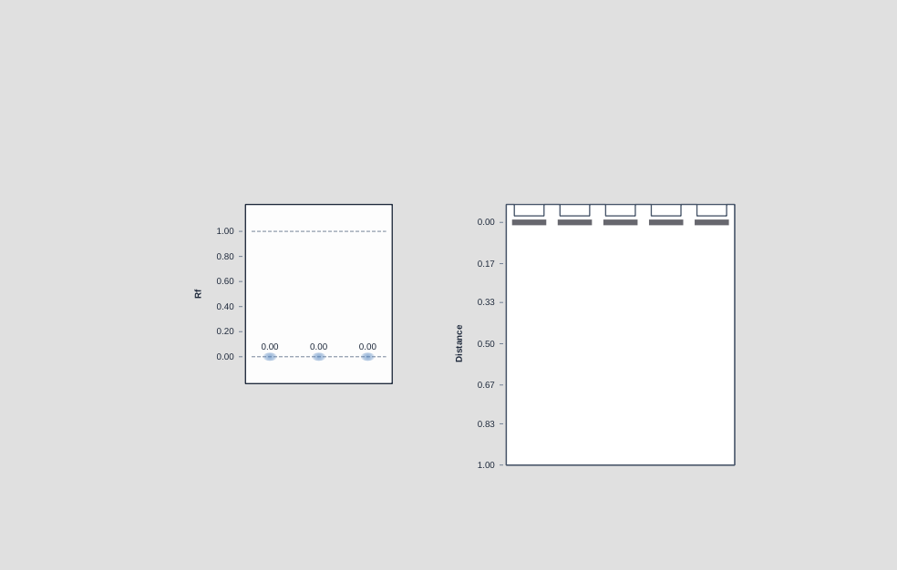

*Figura 25. Ejemplo didáctico, no experimental: placa TLC (izquierda), con manchas en Rf 0,25 / 0,55 / 0,80, y gel de electroforesis (derecha), con cinco pozos y bandas a distintas alturas. Las escalas muestran Rf y distancia, respectivamente.*

> **Advertencia de uso.** Estos objetos son material gráfico para comunicar un resultado. ChemUSON no analiza imágenes de cromatografía ni calcula Rf a partir de una fotografía: el valor que usted escriba es el que se muestra.

---

## 10. Selección, transformación y navegación

### 10.1 Seleccionar

| Acción | Cómo |
|---|---|
| Seleccionar un objeto | Clic con la herramienta **Seleccionar** (`V`). |
| Sumar o quitar objetos | `Shift` + clic o `Ctrl` + clic sobre cada objeto (alterna su estado). |
| Selección rectangular | Arrastre sobre zona vacía. |
| Selección libre (lazo) | Herramienta **Seleccion libre** (segundo clic sobre el botón Seleccionar), o bien `Ctrl` + arrastre sobre zona vacía con la herramienta **Seleccionar** activa. |
| Seleccionar todo | `Ctrl+A` o `Ctrl+E`, o el menú contextual. |
| Cancelar selección | Clic en zona vacía o `Esc`. |

### 10.2 Mover y ajustar

- **Arrastrar** la selección la desplaza.
- **Flechas del teclado:** desplazan 1 px; con `Shift`, 10 px.
- **Redimensionar selección...** (`Ctrl+Alt+S`): cuadro con factores numéricos.
- **Duplicar** (`Ctrl+D`) y **Eliminar** (`Supr` o `Retroceso`).

> **Nota de edición.** En 0.3.0-beta.4 no hay ordenación ni alineación automática de objetos en la barra de herramientas: la alineación se hace con el cursor y la cuadrícula (**Ver → Visualización → Cuadrícula**).

### 10.3 Atajos numéricos sobre un objeto

| Puntero sobre… | Tecla | Resultado |
|---|---|---|
| Un átomo | `1`…`9` | Añade una cadena de esa longitud. |
| Un átomo | `Shift` + `3`…`9` | Inserta un anillo de ese tamaño. |
| Un enlace | `1`, `2`, `3` | Cambia el orden del enlace. |
| Un enlace | `Shift` + cifra | Fusiona un anillo de ese tamaño sobre el enlace. |

### 10.4 Navegación por el lienzo

| Acción | Cómo |
|---|---|
| Acercar / alejar | Rueda del ratón, o `Ctrl++` / `Ctrl+-` / `Ctrl+0`. |
| Desplazar | Botón central del ratón, `Espacio` + arrastre, o `Shift` + rueda (horizontal). |
| Invertir la orientación de un doble enlace seleccionado | `Ctrl+Alt` + rueda del ratón. |
| Reglas y cuadrícula | **Ver → Visualización → Reglas / Cuadrícula**. |
| Cambiar el tamaño del papel | **Ver → Tamaño de lienzo**. |
| Saltar al siguiente error de valencia | `F8` / `Shift+F8`. |

---

## 11. Menú contextual

El clic derecho **no muestra siempre el mismo menú**: las entradas dependen del objeto bajo el puntero y de lo que haya seleccionado. Esto es importante, porque varias funciones solo se alcanzan así.

### 11.1 Sobre un átomo

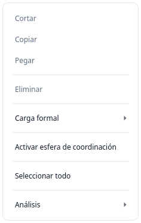

*Figura 26. Clic derecho sobre un átomo: **Cortar**, **Copiar**, **Pegar**, **Eliminar**, **Carga formal ▸*, **Activar esfera de coordinación** y **Análisis ▸**.*

Las entradas **Reordenar rama**, **Color de enlace…** y **Elegir átomo de unión…** aparecen además cuando el átomo pertenece a una cadena con ramas.

### 11.2 Sobre un enlace

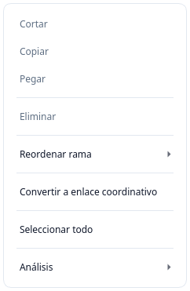

*Figura 27. Clic derecho sobre un enlace: además de las acciones básicas ofrece **Reordenar rama ▸** (con **Girar ±60°**, **Invertir rama (180°)** y **Autoacomodar rama**), **Color de enlace…**, **Convertir a enlace coordinativo** y los submenúes de análisis.*

### 11.3 Sobre una selección

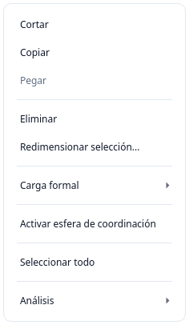

*Figura 28. Con varios objetos seleccionados se añade **Redimensionar selección...** y **Grosor de enlace/flecha/corchete**; las entradas específicas de un átomo o enlace concreto solo aparecen si el puntero está encima de uno de ellos.*

### 11.4 Sobre el lienzo vacío

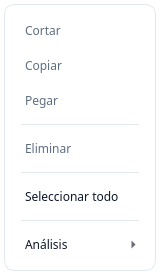

*Figura 29. Sin objeto bajo el puntero, el menú se reduce a **Pegar**, **Seleccionar todo** y **Análisis ▸** (las entradas de edición requieren una selección).*

### 11.5 Submenú Análisis

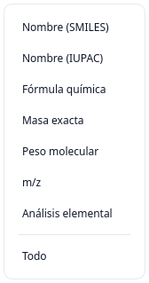

*Figura 30. **Análisis** en el menú contextual de 0.3.0-beta.4. Incluye **Nombre (IUPAC)**, que no aparece en el menú **Estructura → Análisis**.*

Todas las entradas de **Análisis** escriben el resultado **como texto dentro del propio lienzo**, debajo de la estructura, y la inserción se puede deshacer. Compare con el menú **Estructura → Análisis**, que ofrece el mismo conjunto **menos «Nombre (IUPAC)»**. El detalle de cada resultado está en [Análisis químico](#14-análisis-químico-nomenclatura-y-validación).

### 11.6 Objeto por objeto

| Objeto bajo el puntero | Entradas propias del menú contextual |
|---|---|
| Átomo | **Carga formal ▸* (Incrementar (+1), Disminuir (-1), Establecer..., Restablecer a 0, **No implícitos**), **Activar esfera de coordinación**, **Estilo de esfera ▸**. Si el átomo es un centro de coordinación con varios ligandos, aparece **Distribuir ligandos alrededor**. |
| Enlace | **Reordenar rama ▸**, **Color de enlace…**, **Elegir átomo de unión…**, **Convertir a enlace coordinativo**. |
| Flecha o línea | **Grosor de enlace/flecha/corchete ▸** (**Incrementar grosor**, **Disminuir grosor**, **Restablecer grosor**) y, con líneas o flechas, **Longitud de lineas ▸** (**Igualar longitudes** / **Igualar a la linea activa**, **Establecer longitud...**). |
| Corchete o marco | El mismo submenú **Grosor de enlace/flecha/corchete ▸**. |
| Diagrama de energía | **Diagrama de energia ▸**: **Etiqueta...**, **Posición de etiqueta ▸** (**Izquierda**, **Derecha**), **Numero de cajas...** (sobre filas), **Ocupación electrónica...** y el submenú **Estilo ▸** (colores de contorno, relleno, etiqueta y flechas ↑/↓, fondo, contorno y base de cajas, **Restablecer estilo**). |
| Diagrama electrónico (MO, subniveles, campo de ligandos) | **Diagrama electrónico ▸**: **Edit Electronic Diagram...**, **Mostrar resumen inferior**, **Editar título...** y, según el diagrama, **Editar etiqueta de nivel...** y **Editar etiqueta de carril...**. |
| Orbital | **Orbital ▸**: **Color de orbital...**, **Restablecer color de orbital**, **Opacidad de orbital...** y, sobre un orbital concreto, el submenú **Editar lóbulo ▸** (**Color por lóbulo...**, **Opacidad por lóbulo...**, **Mover lóbulo...**, **Restablecer estilo de lóbulo**). |
| Texto | Sin entradas propias: se edita con **doble clic** y se formatea con la barra de contexto de texto ([7.1](#71-texto-y-etiquetas)). |
| Mancha de placa | **Cambiar color...**, **Opacidad ▸**, **Tamano ▸**, **Mostrar Rf** / **Ocultar Rf**, **Set Rf...**, **Eliminar mancha** ([9.2](#92-editar-manchas-y-bandas)). |

> **Cuidado con una diferencia real.** En el menú contextual, **Análisis → Análisis elemental** inserta una tabla de texto en el lienzo; el cuadro de diálogo interactivo de análisis elemental solo está en **Estructura → Análisis → Análisis elemental...**.

---

## 12. Paneles laterales

El panel lateral organiza las siete vistas de consulta y cálculo en un solo espacio del lado derecho. Esta sección explica **cómo se organiza, cómo se activa y cómo se navega**; el contenido de cada vista se describe en el capítulo de la función correspondiente, para no repetirlo.

### 12.1 Cómo se organiza

| Pestaña | Contenido | Dónde se explica |
|---|---|---|
| **Inspector** | Datos del objeto seleccionado o del documento. | [12.3](#123-inspector) |
| **Validación** | Lista de problemas de valencia. | [14.3](#143-validación-de-valencias) |
| **Propiedades** | Propiedades químicas del documento. | [14.4](#144-propiedades-químicas) |
| **Plantillas** | Biblioteca de plantillas. | [13. Plantillas](#13-plantillas) |
| **Apariencia** | Ajustes de representación del documento. | [18.1](#181-preferencias) |
| **Espectroscopía** | Predicción orientativa de ¹H NMR, ¹³C NMR y MS. | [14.5](#145-espectroscopía-orientativa) |
| **CompChem** | Entrada de cálculos ORCA, Gaussian y NWChem. | [15.2](#152-panel-compchem) |

Las siete vistas se activan desde **Ver → Paneles** (figura 5). El panel comienza **oculto** en una instalación nueva. Actívelo con **Ver → Paneles → Panel lateral**, con el botón de paneles de la barra superior o con la entrada concreta que necesite.

### 12.2 Cómo navegar

- Las cinco primeras vistas se ven como pestañas; las restantes (**Espectroscopía** y **CompChem**) están tras el botón **…** (*Más paneles*).
- Para volver a ocultar el panel, desactive **Ver → Paneles → Panel lateral**.
- El panel no modifica la estructura: solo lee el documento o abre diálogos que sí lo modifican.

### 12.3 Inspector

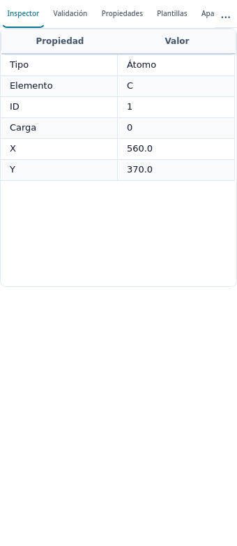

*Figura 31. Vista **Inspector** con un átomo seleccionado. Es una vista de solo lectura: para editar, use el lienzo o el menú contextual.*

Muestra, según lo seleccionado, el tipo de objeto, el elemento, la carga formal, el orden y estilo de enlace o los parámetros del objeto gráfico. Si no hay nada seleccionado, muestra la información del documento y el mensaje «Nada seleccionado».

---

## 13. Plantillas

Las plantillas son fragmentos predefinidos que se insertan completos en el lienzo. **Esta es la única sección del manual que describe la biblioteca y su gestión**; los menús que llevan a ella se mencionan sin repetir el procedimiento.

Hay dos caminos equivalentes para insertar una plantilla: el submenú **Estructura → Plantillas** (figura 7) y la vista **Plantillas** del panel lateral (figura 32).

### 13.1 La biblioteca

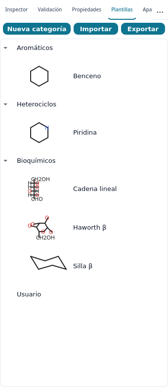

*Figura 32. Vista **Plantillas** del panel lateral con la biblioteca de fábrica: categorías **Aromáticos**, **Heterociclos**, **Bioquímicos** y **Usuario**. Los botones superiores son **Nueva categoría**, **Importar** y **Exportar**.*

La biblioteca que trae el programa es deliberadamente breve. Estas son **todas** las plantillas de fábrica en 0.3.0-beta.4:

| Categoría | Plantillas incluidas |
|---|---|
| **Aromáticos** | Benceno |
| **Heterociclos** | Piridina |
| **Bioquímicos** | Cadena lineal, Haworth β, Silla β |
| **Usuario** | Vacía: aquí se guardan las suyas. |

La potencia del sistema está en que **usted amplía la biblioteca**: dibuje el fragmento una vez y guárdelo como plantilla ([13.3](#133-crear-organizar-y-compartir)). El panel lateral muestra cada entrada con su miniatura y nombre; el submenú del menú solo lista los nombres.

### 13.2 Insertar una plantilla

1. Abra **Estructura → Plantillas** o la vista **Plantillas** del panel.
2. Pulse la plantilla deseada.
3. El cursor queda en modo de inserción: **haga clic en el punto del lienzo** donde quiera colocarla.
4. `Esc` cancela la inserción antes de hacer clic.

Si la plantilla encaja con un átomo existente, ChemUSON **funde** la estructura (comparte ese átomo) en lugar de superponer dos esqueletos.

### 13.3 Crear, organizar y compartir

| Acción | Dónde |
|---|---|
| **Guardar selección como plantilla...** | **Estructura → Plantillas**. Seleccione antes la parte del dibujo; pida un nombre y elija la categoría. |
| **Nueva categoría...** | **Estructura → Plantillas** o botón **Nueva categoría** del panel. |
| **Importar biblioteca...** / botón **Importar** | Carga una biblioteca externa en el formato propio de ChemUSON. |
| **Exportar biblioteca...** / botón **Exportar** | Guarda la biblioteca completa, incluidas las plantillas de usuario. |

La biblioteca completa se guarda en un único archivo del perfil: `~/.config/Chemuson/template_library.json` en Linux (o `$XDG_CONFIG_HOME/Chemuson/template_library.json`; la variable `CHEMUSON_CONFIG_HOME` lo reubica) y `%APPDATA%\Chemuson\template_library.json` en Windows. Así sus plantillas siguen disponibles en las sesiones siguientes. Exporte la biblioteca antes de cambiar de equipo.

> **Modos adicionales de selección de elementos.** En esta versión la elección de elementos se hace con la paleta de **Átomos** y la **Tabla periódica** ([5.5](#55-herramienta-átomos)). Otras formas de seleccionar elementos de forma agrupada podrían revisarse en el futuro; no hay ninguna operativa en 0.3.0-beta.4.

---

## 14. Análisis químico, nomenclatura y validación

### 14.1 Dónde está cada cosa

| Función | Ruta |
|---|---|
| Nombre, fórmula, masa, peso molecular, m/z, análisis elemental | **Estructura → Análisis** y **Análisis** en el menú contextual. |
| Nombre (IUPAC) | Solo en el **menú contextual → Análisis**. |
| Nombre a estructura, importar/exportar SMILES | **Estructura**. |
| Copiar SMILES, Molfile, CML, InChI | **Editar → Copiar como**. |
| Propiedades químicas | Panel lateral → **Propiedades**. |
| Validación de valencias | **Estructura** y panel **Validación**. |
| Espectroscopía orientativa | Panel lateral → **Espectroscopía** (tras **…**). |

### 14.2 Análisis: qué devuelve cada entrada

| Entrada | Resultado |
|---|---|
| **Nombre (SMILES)** | Inserta el nombre estimado por ChemName y, debajo, el SMILES equivalente. |
| **Nombre (IUPAC)** *(solo menú contextual)* | Inserta el nombre generado por el motor ChemName. |
| **Fórmula química** | Texto «Chemical Formula: …» con la fórmula ordenada. |
| **Masa exacta** | Texto «Exact Mass: …». |
| **Peso molecular** | Texto «Molecular Weight: …». |
| **m/z** | Tabla simulada del patrón isotópico del ion molecular. |
| **Análisis elemental...** | **Diálogo interactivo** con tabla de porcentajes másicos (usa la fórmula de **todo el documento**). Desde el menú contextual, **Análisis elemental** no abre el diálogo: inserta la tabla como texto. |
| **Todo** | Inserta nombre, fórmula, masa exacta, peso molecular y análisis elemental en una sola anotación. |

Tres detalles prácticos, comprobados en 0.3.0-beta.4:

1. **Los resultados se escriben en el lienzo** como una caja de texto situada bajo la estructura. Puede moverla, editarla o eliminarla con `Ctrl+Z`.
2. **Las etiquetas aparecen en inglés** («Chemical Formula:», «Exact Mass:», «Molecular Weight:», «Elemental Analysis:») porque son las cadenas internas de la aplicación. Bórelas o tradúzcalas a mano si prepara una figura publicada.
3. **El análisis elemental cubre unos diecisiete elementos** (C, H, N, O, F, S, P y los halógenos habituales, entre otros). Con elementos fuera de esa lista, el resultado se muestra como **N/D**.

### 14.3 Validación de valencias

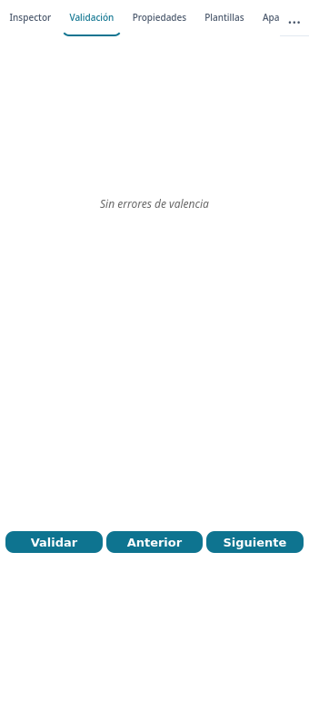

*Figura 33. Vista **Validación** después de validar el benceno de la Figura 1: no hay errores, por eso el área aparece vacía con el aviso «Sin errores de valencia». Los botones **Validar**, **Anterior** y **Siguiente** revisan y recorren los avisos.*

Ejecute **Estructura → Validar valencias** (`Ctrl+Shift+V`) o el botón **Validar** de la propia vista, y recorra los avisos con `F8` / `Shift+F8` o con **Anterior** y **Siguiente**. Si hay problemas, la vista se llena con una tabla de seis columnas: **Afectado**, **Sev.**, **Código**, **Valencia**, **Mensaje** y **Sugerencia**. Cada fila indica el átomo o enlace afectado, la severidad, el código interno, la valencia observada y el mensaje. Cuando la aplicación dispone de una corrección segura, aparece un selector con la opción y el botón **Aplicar corrección**; cuando no la hay, la fila solo informa y la corrección es manual.

ChemUSON **no cambia la química por sí solo**: no añade ni elimina hidrógenos ni modifica enlaces sin que usted lo confirme.

### 14.4 Propiedades químicas

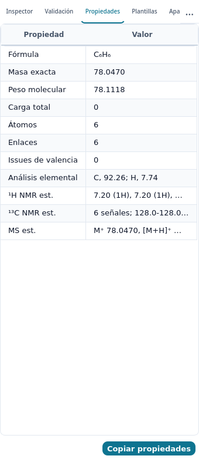

*Figura 34. Vista **Propiedades** del benceno de la Figura 1. La tabla tiene dos columnas, **Propiedad** y **Valor**.*

La vista resume el documento en once filas: **Fórmula**, **Masa exacta**, **Peso molecular**, **Carga total**, **Átomos**, **Enlaces**, **Issues de valencia**, **Análisis elemental**, **¹H NMR est.**, **¹³C NMR est.** y **MS est.** Las cuatro últimas son un resumen de una sola línea de lo que calculan las vistas de análisis y espectroscopía. El botón **Copiar propiedades** copia la tabla **al portapapeles en formato de columnas separadas por tabuladores**; no genera ningún archivo. Péguela en una hoja de cálculo si necesita ordenarla.

### 14.5 Espectroscopía orientativa

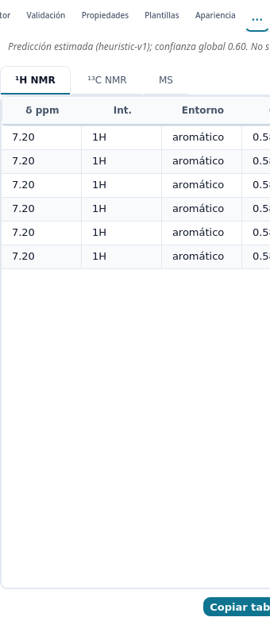

*Figura 35. Vista **Espectroscopía** con la predicción estimada del benceno. La cabecera indica el método y la confianza global del cálculo; debajo hay pestañas **¹H NMR**, **¹³C NMR** y **MS**, y los botones **Copiar tabla** y **Exportar tabla...***

Abra **Ver → Paneles → Espectroscopía**. La predicción **se calcula sola** al cambiar la estructura: no hay botón «Analizar». Aparecen tres pestañas con estas columnas:

| Pestaña | Columnas |
|---|---|
| **¹H NMR** | **δ ppm**, **Int.**, **Entorno**, **Conf.**, **Átomo** |
| **¹³C NMR** | **δ ppm**, **Entorno**, **Conf.**, **Átomo** |
| **MS** | **m/z**, **Int. %**, **Pico**, **Conf.** |

Bajo las tablas puede copiarlas al portapapeles (**Copiar tabla**) o exportarlas a un archivo (**Exportar tabla...**).

> **Lea esto antes de usarlas.** Las predicciones son **heurísticas** (`heuristic-v1`): ChemUSON asigna rangos típicos de desplazamiento químico a partir del entorno inmediato del núcleo y muestra una **confianza** orientativa (0,60 en el ejemplo de la Figura 35; el valor cambia según la estructura). No sustituyen a un simulador espectroscópico ni, desde luego, a un espectro experimental. No las use para asignar estructuras en un trabajo científico sin contraste experimental.

### 14.6 Nombre a estructura (con aviso de privacidad)

**Estructura → Nombre a estructura...** escribe un nombre y devuelve la estructura correspondiente.

- **Fuente local:** una tabla interna con **diez sustancias** y su nombre en español y en inglés: agua, metano, etano, etanol, metanol, acetona, benceno, tolueno, fenol y ácido acético. Funciona sin conexión.
- **Servicio externo:** si el nombre no está en la tabla interna y hay conexión, la aplicación **consulta PubChem de forma predeterminada**. Si trabaja con compuestos confidenciales, desconecte la consulta o ejecute el programa sin red.
- Las consultas correctas se cachean en `~/.chemuson/name2structure_cache.json` para repetirlas sin red.

> **Nomenclatura.** ChemUSON no genera nomenclatura IUPAC completa ni valida nombres sistemáticos largos: el motor ChemName es un generador simplificado. Los nombres se marcan como **estimados** y, cuando no puede derivarlos, aparecen como **N/D** en la barra de estado.

---

## 15. Química computacional 3D y asistente molecular

### 15.1 Visor molecular 3D

Active **Ver → Visor molecular 3D** para abrir el visor tridimensional del documento actual. No es una simple ventana de visualización: permite trabajar la geometría en tres dimensiones.

| Control | Función |
|---|---|
| Arrastrar sobre una zona vacía | Orbitar la cámara (girar la molécula). |
| Rueda del ratón | Acercar y alejar. |
| **Fit** | Encuadrar toda la molécula. |
| Selector de representación | **Bolas y varillas**, **Alambre** o **Espacio lleno**. |
| **Controles de edición ▸** | Despliega las herramientas de trabajo tridimensional. |
| **Editar geometría 3D** | Activa la edición directa de coordenadas en el visor. |
| Herramienta | **Mover átomo/fragmento**, **Construir molécula**, **Seleccionar**, **Enlazar átomos**, **Medir geometría** y **Ajustar geometría (handles)**. |
| Elemento / orden de enlace | Cambian el átomo o el enlace seleccionados (elementos de la lista: C, N, O, F, P, S, Cl, Br, I). |
| **Live MM (RDKit)** y **Campo Live MM** | Refina la geometría «en vivo» con **MMFF94**, **MMFF94s** o **UFF** mientras manipula la estructura. |

La geometría tridimensional parte del dibujo 2D y se aproxima con campos de fuerza; **no es el resultado de un cálculo cuántico**. Para eso use **CompChem** y un motor externo.

> **Sin captura de este visor.** El visor tridimensional se dibuja con OpenGL y no pudo capturarse de forma fiable en el entorno sin pantalla usado para este manual. Por eso el capítulo no incluye una figura del visor: preferimos no incluir una imagen que no sea una captura auténtica del producto.

> **Otros dos huecos de ilustración.** La paleta de la herramienta **Texto** y la **barra de formato de texto** que aparece al escribir ([7.1](#71-texto-y-etiquetas)) tampoco tienen figura en esta edición: se describen en texto con sus controles y atajos, y quedarán pendientes de una captura en una revisión posterior.

Para geometría y energías calculadas, use el panel **CompChem** con un motor externo instalado en su equipo.

### 15.2 Panel CompChem

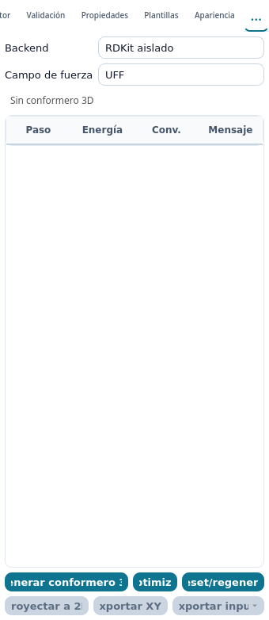

*Figura 36. Vista **CompChem** recién abierta: selectores **Backend** y **Campo de fuerza**, indicador de estado, tabla de seguimiento y los seis botones de trabajo geométrico y de exportación.*

Abra **Ver → Paneles → CompChem**. La vista prepara geometría y archivos de entrada:

| Control | Función |
|---|---|
| **Backend** | Motor de geometría: **RDKit aislado** (por defecto) u **Open Babel**. |
| **Campo de fuerza** | **UFF**, **MMFF94** o **MMFF94s**. |
| **Generar conformero 3D** | Construye un conformero tridimensional a partir del dibujo 2D. |
| **Optimizar** | Optimiza la geometría con el campo de fuerza elegido. |
| **Reset/regenerar** | Descarta la geometría 3D y vuelve al dibujo plano. |
| **Proyectar a 2D** | Vuelca la geometría tridimensional sobre el lienzo plano. |
| **Exportar XYZ** | Guarda las coordenadas tridimensionales en un archivo `.xyz`. |
| **Exportar input ▾** | Escribe el archivo de entrada del motor que elija en el desplegable: **ORCA**, **Gaussian** o **NWChem**. |

La tabla intermedia registra el avance con las columnas **Paso**, **Energía**, **Conv.** y **Mensaje**.

> **Qué no hace ChemUSON.** No ejecuta cálculos: produce el archivo de entrada que usted debe correr en su propio ORCA, Gaussian o NWChem, y luego puede importar o dibujar los resultados en el editor.

### 15.3 Asistente molecular (experimental)

**Estructura → Dibujar estructura con IA...** y **Transformar molécula seleccionada con IA...** abren el asistente que construye o modifica estructuras a partir de una descripción escrita.

El propio cuadro del asistente reúne la configuración y la petición. Sus grupos:

| Grupo | Controles |
|---|---|
| Petición | **Descripción** y, en el modo de dibujo, **Método de resolución**: **IA + referencia**, **Solo IA** o **Referencia química**. |
| **Referencias químicas** | Casilla **Permitir referencias químicas externas (PubChem)**. Sin marcar, las referencias químicas se limitan a fuentes locales y caché; esta opción no controla la conexión del proveedor IA. |
| **Proveedor IA** | **Proveedor** (**OpenAI-compatible (personalizado)**, **OpenAI**, **LM Studio**, **llama.cpp server**), **Endpoint base**, **Modelo** y la clave del proveedor. |
| **Opciones avanzadas** | **Timeout (s)** (60 por defecto), **Máximo de tokens de salida** (4096 por defecto) y **Solicitar salida JSON estructurada si el endpoint la admite**. |

Los métodos de dibujo se distinguen así:

- **Solo IA** utiliza el proveedor configurado, que puede ser local o remoto.
- **Referencia química** consulta las fuentes químicas permitidas por la configuración, sin llamar al modelo.
- **IA + referencia** combina ambos mecanismos cuando corresponde; la consulta de referencia depende de que se reconozca una petición de molécula por nombre.

> **Privacidad de la investigación.** Deshabilitar PubChem no impide que un proveedor remoto de IA reciba la descripción y, en una transformación, información de la estructura seleccionada. Si trabaja con estructuras inéditas, confidenciales o sujetas a restricciones de divulgación, revise el endpoint, las políticas del proveedor y las autorizaciones antes de enviar datos. Un proveedor puede evitar enviar la descripción a servicios externos solo si realmente se ejecuta localmente y no utiliza servicios remotos.

Estado real en 0.3.0-beta.4:

- La función está incluida pero es **experimental**; la interfaz no lo marca con ninguna etiqueta, así que considérela inestable.
- **No funciona sin configurar el proveedor**: necesita un *Endpoint base* y un *Modelo*, y una clave cuando el proveedor lo exige. Los perfiles **LM Studio** y **llama.cpp server** apuntan por defecto a un servidor local.
- Las estructuras generadas **deben revisarse**: valide valencias y fórmula antes de darlas por correctas.

---

## 16. Archivos, formatos y exportación

### 16.1 Abrir y guardar

| Operación | Formatos admitidos |
|---|---|
| **Abrir** (`Ctrl+O`) | `.cmsn` (formato propio), `.mol` (MOL V2000), `.cml` y todos los archivos del disco. |
| **Guardar** (`Ctrl+S`) | `.cmsn` o `.cml`. |
| **Exportar como** | **PNG**, **SVG**, **PDF**, **CML** y **Estructura molecular (MOL)**. |

Puntos comprobados en 0.3.0-beta.4 que conviene conocer:

- **`.sdf` no está soportado.** Al intentar abrirlo o exportarlo, ChemUSON muestra «SDF multi-registro no está soportado; abre un archivo MOL (.mol)». Trabaje con un `.mol` o `.cml` por estructura.
- **Arrastrar y soltar archivos sobre la ventana no está disponible.** Use **Archivo → Abrir**.
- El diálogo **Abrir archivo(s)** permite seleccionar **varios archivos a la vez**: cada uno se abre en su propia pestaña.
- Guardar **sobrescribe** el archivo actual sin copia de seguridad propia; los respaldos automáticos se gestionan aparte ([capítulo 17](#17-guardado-automático-y-recuperación)).

### 16.2 Pegar contenido externo

Con `Ctrl+V`:

| Contenido del portapapeles | Comportamiento |
|---|---|
| Selección previa de ChemUSON | Se pegan todos los objetos (átomos, enlaces, textos, flechas…). |
| Texto SMILES | Se interpreta **únicamente como SMILES** y se construye la estructura. |
| Molfile con formato interno de ChemUSON | Se importa como estructura (es lo que produce **Editar → Copiar como → Molfile**). |
| Ruta de archivo copiada en el gestor de archivos | Se inserta el archivo de imagen referido. |
| Imagen (PNG, JPG, SVG) | Se inserta como imagen y se ajusta como máximo al 72 % del tamaño del papel. |

> **Nota sobre el texto plano.** Un bloque de texto del portapapeles se interpreta **solo como SMILES**. Un Molfile pegado como texto plano desde otro programa no se importa: cópielo con **Copiar como → Molfile** de ChemUSON, o bien abra el archivo con **Archivo → Abrir**.

### 16.3 Exportar para publicar

- **PNG**: mapa de bits del lienzo completo; permite elegir el fondo y el recorte.
- **SVG** y **PDF**: vectores, recomendados para figuras de artículo o póster.
- **CML** y **MOL**: intercambian la información estructural con otros programas.
- **Estructura → Exportar SMILES...** y **Editar → Copiar como → SMILES** llevan el SMILES al portapapeles; **no** crean un archivo.

Las etiquetas de los resultados de análisis y ciertos textos de los diagramas electrónicos se exportan **en inglés** (son cadenas internas). Revíselas antes de enviar una figura.

### 16.4 Documentos y pestañas

Cada documento abierto ocupa una pestaña. Puede tener varios documentos a la vez; para cerrar uno pulse la **×** de su pestaña: si tiene cambios sin guardar, ChemUSON pregunta antes de cerrar.

---

## 17. Guardado automático y recuperación

ChemUSON guarda respaldos del documento activo de forma transparente:

- **Cada 120 segundos** y **8 segundos después** de dejar de editar.
- Se conservan como máximo **5 respaldos** por documento.
- La carpeta base es `~/.chemuson` (o `$XDG_CONFIG_HOME/chemuson` si esa variable está definida).

### 17.1 Centro de recuperación

Abra **Archivo → Centro de recuperación...**. Tiene tres pestañas:

| Pestaña | Contenido |
|---|---|
| **Pendientes** | Respaldos que el programa encontró al iniciarse tras un cierre anormal. |
| **Recientes** | Respaldos guardados en la sesión actual. |
| **Recuperados** | Documentos ya recuperados. |

Al recuperar un documento, los respaldos anteriores se archivan en la subcarpeta `autosave/old/` para que no se pierdan.

### 17.2 Si el programa se cierra inesperadamente

1. Vuelva a abrir ChemUSON: el **Centro de recuperación** se muestra solo si hay respaldos pendientes.
2. Elija el respaldo más reciente y compruebe la estructura recuperada.
3. Guárdelo con **Guardar como** en una ruta definitiva.

El guardado automático **no sustituye** a `Ctrl+S`: no guarda en su archivo y se limita a cinco copias.

---

## 18. Preferencias y actualizaciones

### 18.1 Preferencias

Ábralas con **Editar → Preferencias...** o con el botón de la barra superior. El diálogo tiene cuatro pestañas:

| Pestaña | Controles que muestra |
|---|---|
| **General** | Casillas **Mostrar carbonos implícitos**, **Mostrar hidrógenos implícitos** y **Aromáticos como círculos**. |
| **Apariencia** | **Bordes de enlace**: **Redondeados** o **Rectos**. |
| **Actualizaciones** | Un resumen del comportamiento del actualizador, la casilla **«Buscar actualizaciones cuando esta edición lo permita»**, **Canal** (**Estable** o **Beta**) y **Modo de aplicación** (**Notificar antes de aplicar** o **Preparar en silencio cuando sea posible**). |
| **RDKit** | Casillas **Nombre avanzado (fase 4/6)** y **Usar RDKit aislado**. |

Dos aclaraciones verificadas:

- La casilla **«Usar RDKit aislado»** (pestaña RDKit) controla la ejecución de RDKit en un proceso separado; afecta a los descriptores estereoquímicos que usa ChemName. No activa ni desactiva el resto de funciones: fórmula, masa, SMILES y limpieza 2D se resuelven con la lógica interna del programa.
- El tema claro/oscuro **no** está en este diálogo: se cambia con el botón de la barra superior. La visualización de carbonos e hidrógenos puede ajustarse también desde **Ver → Visualización**.
- Las preferencias de **Apariencia del documento** (por ejemplo «Bordes de enlace») están en la vista **Apariencia** del panel lateral, no en el diálogo de preferencias.


*Figura 37. Vista **Apariencia** del panel lateral: ajustes de representación propios del documento abierto.*

### 18.2 Cambiar el tema

Use el botón de tema de la barra superior para alternar entre claro y oscuro. Ambos temas se muestran en las figuras 1 y 2.

### 18.3 Buscar actualizaciones

**Ayuda → Buscar actualizaciones...** comprueba si hay una versión más nueva en el canal que usted tenga seleccionado (**Estable** o **Beta**, en **Preferencias → Actualizaciones**) y se lo indica. Lo que ocurre después **depende de cómo instaló ChemUSON**, y en algunos casos el programa sí aplica la actualización:

| Instalación | Comportamiento comprobado en 0.3.0-beta.4 |
|---|---|
| **AppImage (Linux)** y **ejecutable portable (Windows)** | ChemUSON descarga la actualización y, **al cerrar la aplicación**, sustituye el binario actual. Antes de sustituirlo **verifica** el archivo descargado y **guarda una copia de seguridad** del binario; si la verificación falla muestra «No se reemplazará binario no verificado» y no toca nada, y si el reemplazo falla intenta restaurar la copia (mecanismo básico de rollback). Si no tiene permisos para escribir donde está el ejecutable, avisa y no aplica nada. |
| **Instalador de Windows** | Descarga el instalador oficial y lo **ejecuta en silencio al cerrar ChemUSON**. El cuadro de diálogo lo advierte con estas palabras: «Esta edición no usa auto-update real. ChemUSON descargará el instalador oficial y lo ejecutará en silencio al cerrar.» Después ofrece cerrar el programa en ese momento. |
| **Flatpak** | La actualización integrada está **desactivada**: el programa le indica que use `flatpak update io.github.PJGV333.Chemuson`. |

Con el modo **Preparar en silencio cuando sea posible** y las comprobaciones automáticas activadas, la preparación se encola sin preguntarle; con **Notificar antes de aplicar** siempre se le pide confirmación.

> **Guarde antes de aceptar.** Aplicar una actualización cierra ChemUSON. Guarde el documento (o confíe en el guardado automático, [capítulo 17](#17-guardado-automático-y-recuperación)) antes de confirmar.

---

## 19. Referencia de atajos

Todos los atajos listados son los que la propia interfaz de 0.3.0-beta.4 muestra o procesa.

### 19.1 Documento

| Atajo | Acción |
|---|---|
| `Ctrl+N` | Nuevo documento |
| `Ctrl+O` | Abrir |
| `Ctrl+S` · `Ctrl+G` | Guardar |
| `Ctrl+P` | Paleta de comandos |

> **Salir.** La entrada **Archivo → Salir** no muestra atajo en la interfaz de esta versión; no asuma `Ctrl+Q`.

### 19.2 Edición

| Atajo | Acción |
|---|---|
| `Ctrl+Z` / `Ctrl+Y` | Deshacer / Rehacer |
| `Ctrl+C` / `Ctrl+X` / `Ctrl+V` | Copiar / Cortar / Pegar |
| `Ctrl+D` | Duplicar selección |
| `Supr` o `Retroceso` | Eliminar selección |
| `Ctrl+A` · `Ctrl+E` | Seleccionar todo |
| `Ctrl+Alt+S` | Redimensionar selección... |
| `Flechas` / `Shift` + `Flechas` | Desplazar 1 px / 10 px |
| `Esc` | Cancelar la operación en curso |

### 19.3 Dibujo

| Atajo | Acción |
|---|---|
| `V` | Herramienta Seleccionar |
| `B` | Herramienta Enlaces |
| `L` | Herramienta Cadena |
| `R` | Herramienta Anillos |
| `C` | Herramienta Átomos |
| `T` | Herramienta Texto |
| `N` | Herramienta Flechas |
| `G` | Herramienta Corchetes |
| `E` | Herramienta Diagramas de energía |
| `O` | Herramienta Orbitales |
| `1`…`9` sobre un átomo | Cadena de esa longitud |
| `Shift` + `3`…`9` sobre un átomo | Anillo de ese tamaño |
| `1` / `2` / `3` sobre un enlace | Cambiar orden del enlace |
| `Ctrl+B` / `Ctrl+I` / `Ctrl+U` | Negrita / Cursiva / Subrayado del texto |
| `Ctrl+=` | Subíndice |
| `Ctrl+Shift+=` | Superíndice |
| `Ctrl+Shift+↑` / `↓` / `0` | Grosor de trazo mayor / menor / normal |

> **Corchetes, símbolos y placas no tienen tecla asignada**: ábralos con segundo clic o clic derecho sobre su botón del rail.
> **`Ctrl++`** está reservado a **Zoom +**; el aumento de tamaño de fuente desde la paleta es la vía segura.

### 19.4 Estructura y análisis

| Atajo | Acción |
|---|---|
| `Ctrl+K` | **Limpiar 2D (1 paso)** — limpieza recomendada |
| `Ctrl+Shift+K` | Limpiar 2D para publicación |
| `Ctrl+Alt+K` | Proponer conformero 2D |
| `Ctrl+Shift+V` | Validar valencias |
| `F8` / `Shift+F8` | Siguiente / anterior error de valencia |
| `Ctrl+Alt+←` / `→` | Girar rama −60° / +60° |
| `Ctrl+Alt+I` | Invertir rama (180°) |
| `Ctrl+Alt+A` | Autoacomodar rama |
| `Alt` + arrastre | Rotación interactiva de la estructura |
| `Alt+0` | Restablecer orientación |

### 19.5 Vista

| Atajo | Acción |
|---|---|
| `Ctrl++` / `Ctrl+-` / `Ctrl+0` | Zoom + / Zoom − / Zoom 100 % |
| `Espacio` + arrastre | Desplazar el lienzo |
| Rueda del ratón | Zoom |
| `Shift` + rueda | Desplazamiento horizontal |
| `Ctrl+Alt` + rueda | Invertir la orientación de un doble enlace seleccionado |

---

## 20. Limitaciones conocidas

Situación real de ChemUSON 0.3.0-beta.4, comprobada en el programa:

**Alcance del proyecto.**

- Es una versión **beta** en desarrollo activo: menús, atajos y resultados pueden cambiar entre versiones.
- El menú **Reacción** contiene solo la entrada **Próximamente**, desactivada: no hay mapas de reacción ni balance de ecuaciones.
- El menú **Ayuda** no incluye todavía una entrada para abrir este manual ([4.6](#46-ayuda)).

**Química y resultados.**

- El generador de nombres (ChemName) es un IUPAC **simplificado**: no cubre sistemas fusionados complejos, heterocliclos avanzados ni todos los casos multifuncionales. Cuando no puede derivar un nombre, muestra **N/D**.
- El **análisis elemental** solo tabula unos diecisiete elementos; para el resto devuelve **N/D**.
- Las predicciones de **¹H NMR, ¹³C NMR y MS** son heurísticas, con confianza declarada en torno a 0,4. No son datos experimentales ni sustituyen a un simulador validado ([14.5](#145-espectroscopía-orientativa)).
- La geometría tridimensional del visor es aproximada. Para geometrías y energías calculadas se necesita un motor externo; ChemUSON solo **prepara y exporta** el archivo de entrada ([15.2](#152-panel-compchem)).
- **Optimizar con Open Babel** (`obabel`) es una vía alternativa que depende de tener ese programa instalado; no forma parte de la instalación de ChemUSON.

**Formatos e interoperabilidad.**

- **No se abren archivos `.sdf`**, ni CDXML, MRV ni PDB.
- No hay arrastrar y soltar sobre la ventana.
- **Exportar SMILES** copia al portapapeles, no escribe un archivo.

**Comportamientos a tener en cuenta.**

- **`Nombre a estructura...` consulta PubChem por defecto** si el nombre no está en la tabla interna ([14.6](#146-nombre-a-estructura-con-aviso-de-privacidad)).
- El **Asistente molecular** requiere configurar proveedor, punto de acceso y modelo, y no está marcado como experimental en la interfaz ([15.3](#153-asistente-molecular-experimental)).
- Varias etiquetas de resultado se muestran **en inglés**: «Chemical Formula:», «Exact Mass:», «Molecular Weight:», «Elemental Analysis:», los constructores **Atomic diagram…**, **Molecular orbital diagram…** y los presets de diagramas electrónicos.
- **`Limpiar 2D`** (sin atajo) es una entrada duplicada de **`Limpiar 2D (1 paso)`**: en esta versión hacen lo mismo ([4.4.1](#441-limpieza-y-conformación-2d)).
- Cambiar el color u opacidad de una mancha de placa, o eliminarla, **no es deshacible**.
- Algunas funciones de la interfaz usan términos en inglés dentro de menús en español (p. ej. **Electronic Diagrams**, **Copiar como → SMILES**). Se conservan tal cual porque así aparecen en el programa.

**Seguridad y uso científico.** ChemUSON es una herramienta de apoyo. No sustituye a software regulatorio validado, a un cálculo cuántico documentado ni a un análisis experimental. Verifique siempre valencias, fórmula y masa antes de publicar.

---

## 21. Solución de problemas

### La barra de menús ha desaparecido

Use el botón de menú de la barra superior y active **Mostrar barra de herramientas**, o pulse `Ctrl+P` y escriba «menú».

### No sé qué tecla activa cada herramienta

Pase el puntero sobre los botones del rail: el mensaje emergente indica la herramienta y su tecla. La lista completa está en [19.3](#193-dibujo).

### Escribo `C` y no se inserta un carbono

Con el lienzo enfocado, `C` activa la categoría **Átomos** del rail, pero **no inserta por sí sola un carbono**. Para cambiar un elemento, elija su casilla en la paleta y haga clic en el átomo. Si escribe un símbolo, ChemUSON puede abrir el diálogo **Elemento** (como en la interfaz real); confirme el símbolo allí. **Átomos** es el nombre de la categoría del rail; **Elemento** es el título del diálogo y aparece también en el mensaje del botón con el símbolo activo. Consulte [5.5](#55-herramienta-átomos).

### `Ctrl+K` no cambia nada

- La estructura ya estaba ordenada: la barra de estado lo indica.
- La estructura es compleja y ChemUSON la ha protegido para no estropearla: pruebe a **seleccionar solo una parte** y vuelva a pulsar `Ctrl+K`, o use `Ctrl+Shift+K` para una limpieza más exigente.
- Deshaga con `Ctrl+Z` si el resultado no le convence y pruebe `Ctrl+Alt+K` para ver una disposición alternativa.

### La estructura no se nombra

1. **Estructura → Validar valencias** (`Ctrl+Shift+V`) y corrija lo que señale el panel **Validación**.
2. Limpie el dibujo con `Ctrl+K`.
3. Recuerde que la nomenclatura es simplificada: los sistemas complejos pueden quedar en **N/D** ([14.6](#146-nombre-a-estructura-con-aviso-de-privacidad)).

### Necesito girar la molécula

`Alt` + arrastre para girar en el plano; **Editar → Rotar** para giros exactos de 90° y volteos; **Rotación 3D precisa** (paleta de **Seleccionar**) para una perspectiva tridimensional sobre el papel. El visor tridimensional real está en **Ver → Visor molecular 3D** ([capítulo 6](#6-rotación-y-reorientación-de-estructuras)).

### «Rotación 3D precisa» aparece atenuada

Necesita una estructura **seleccionada** y activa. Seleccione la molécula con `Ctrl+A` y vuelva a abrir la paleta de la herramienta **Seleccionar**.

### Una flecha se engancha al átomo equivocado

Mantenga `Alt` mientras coloca el extremo: se desactiva el imán de ajuste.

### Las flechas curvas no salen como quiero

Recuerde que necesitan **tres clics** (origen, extremo, punto de curvatura) y que `Shift` invierte el signo de la curvatura ([7.3](#73-flechas-y-líneas)).

### No puedo abrir mi archivo `.sdf`

En 0.3.0-beta.4 ese formato no está soportado. Conviértalo a `.mol` o `.cml` con otra utilidad y vuelva a intentarlo ([16.1](#161-abrir-y-guardar)).

### El SMILES no se guarda como archivo

**Exportar SMILES...** y **Copiar como → SMILES** copian al portapapeles. Para conservar texto, péguelo en un editor; para un archivo estructural use **Archivo → Exportar como → MOL** o **CML**.

### Los resultados aparecen en inglés

Son cadenas internas de la aplicación. Puede editar el texto insertado en el lienzo con doble clic antes de exportar la figura.

### ChemUSON se cerró de golpe

Abra **Archivo → Centro de recuperación...**. Si necesita diagnosticar el fallo, hay registros en `~/.chemuson/crash_logs/` ([17.2](#172-si-el-programa-se-cierra-inesperadamente)).

### La numeración no aparece en la figura exportada

Active **Ver → Numeración → Incluir numeración en exportación** antes de exportar.

### Falta RDKit

Fórmula, masa, análisis elemental y limpieza 2D funcionan con la lógica interna del programa, sin RDKit. Las funciones que lo necesitan (SMILES, InChI, Molfile, geometría 3D y ciertos descriptores) lo indican cuando fallan. La pestaña **Preferencias → RDKit** ofrece **Nombre avanzado (fase 4/6)** y **Usar RDKit aislado**.

---

## 22. Identidad, licencia y procedencia de las ilustraciones

### Identificación editorial y alcance

- **Versión documentada:** ChemUSON **0.3.0-beta.4** (tag [`v0.3.0-beta.4`](https://github.com/PJGV333/Chemuson/tree/v0.3.0-beta.4)).
- **Fecha de revisión de este manual:** 28 de octubre de 2026.
- **Institución de origen:** Grupo de Química Supramolecular, Universidad de Sonora, México.
- **Autores del proyecto:** Pedro Jancarlo Gomez Vega, José Octavio Juárez Sánchez, Alondra Karolina Montaño Preciado, Jesús David Albino-Espíndola, Ramón Moreno Corral, Felipe Medrano Valenzuela, David Octavio Corona Martínez y Karen L. Ochoa Lara.
- **Licencia:** [AGPL-3.0](../LICENSE). Los informes de errores y las propuestas se gestionan en los [Issues](https://github.com/PJGV333/Chemuson/issues) del repositorio.
- **Advertencia sobre el logotipo:** la identidad visual de ChemUSON es una señal del proyecto y **no** es el escudo oficial de la institución.
- **Advertencia científica:** los resultados (nombres, masas, predicciones espectroscópicas, geometrías) son orientativos y deben verificarse antes de usarse con fines docentes evaluables o de publicación.

### Cómo se verificó este manual

Todas las funciones, rutas de menú, atajos y comportamientos descritos se comprobaron de dos formas complementarias:

1. **Lectura del código** de la propia versión `v0.3.0-beta.4` (construcción de menús en `src/chemuson/gui/main_window_ui_builder.py`, acciones en `src/chemuson/gui/actions/`, paletas del rail en `src/chemuson/gui/toolbar.py` y `src/chemuson/gui/tool_rail.py`, y comportamiento del lienzo en `src/chemuson/gui/canvas/`).
2. **Ejecución real de la aplicación** de esa versión en modo sin pantalla (`QT_QPA_PLATFORM=offscreen`), volcando los menús, los mensajes emergentes del rail, los atajos registrados y capturando las imágenes que se incluyen.

Cuando una función existe pero está incompleta, es experimental o depende de componentes externos, se dice explícitamente en el apartado correspondiente. Cuando no se pudo verificar, no se documenta.

### Procedencia de las ilustraciones

Todas las figuras de este manual son **capturas auténticas de ChemUSON 0.3.0-beta.4**, tomadas de una ejecución de la aplicación sobre el código del tag `v0.3.0-beta.4` en modo sin pantalla. Están en [`docs/manual-figures/`](manual-figures/) y su método de generación se describe en [`docs/manual-figures/README.md`](manual-figures/README.md). Ninguna ilustración ha sido creada a mano ni retocada: solo se han recortado al área relevante.

| Fig. | Archivo | Contenido |
|---|---|---|
| 1 | `01-ventana-tema-claro.png` | Ventana principal en tema claro: lienzo, barra de herramientas y panel lateral. |
| 2 | `02-ventana-tema-oscuro.png` | Ventana principal en tema oscuro. |
| 3 | `47-paleta-comandos.png` | Paleta de comandos y búsqueda rápida (`Ctrl+P`). |
| 4 | `05-menu-editar.png` | Menú Editar y acceso a las transformaciones. |
| 5 | `08-menu-ver-paneles.png` | Submenú Ver → Paneles para mostrar u ocultar vistas. |
| 6 | `03-menu-estructura.png` | Menú Estructura y acciones disponibles en beta.4. |
| 7 | `09-menu-estructura-plantillas.png` | Submenú Estructura → Plantillas. |
| 8 | `04-menu-ayuda.png` | Menú Ayuda tal como aparece en beta.4. |
| 9 | `25-canvas-ordenes-enlace.png` | Ejemplos de enlaces sencillos, dobles y triples. |
| 10 | `26-canvas-estilos-enlace.png` | Ejemplos de estilos gráficos de enlaces. |
| 11 | `11-flyout-atomos.png` | Paleta de Átomos del rail. |
| 12 | `06-menu-editar-rotar.png` | Submenú Editar → Rotar. |
| 13 | `07-menu-rotar-fragmento-pivote.png` | Opciones de rotación de fragmentos con pivote. |
| 14 | `10-flyout-seleccion.png` | Paleta de Selección y herramienta de rotación 3D precisa. |
| 15 | `13-flyout-corchetes.png` | Paleta de Corchetes. |
| 16 | `12-flyout-flechas.png` | Paleta de Flechas y sus variantes. |
| 17 | `20-canvas-flechas-corchetes.png` | Anotaciones de flechas, líneas y corchetes sobre un ciclohexano. |
| 18 | `14-flyout-simbolos.png` | Paleta de Símbolos químicos. |
| 19 | `22-canvas-simbolos-cargas.png` | Ejemplos de cargas y anotaciones químicas. |
| 20 | `16-flyout-energia.png` | Paleta de Diagramas de energía. |
| 21 | `23-canvas-diagramas-energia.png` | Ejemplos de diagramas energéticos y subniveles. |
| 22 | `17-flyout-orbitales.png` | Paleta de Orbitales. |
| 23 | `24-canvas-orbitales.png` | Ejemplos de glifos de orbitales. |
| 24 | `15-flyout-placas.png` | Paleta de Placas TLC y geles. |
| 25 | `21-canvas-placas.png` | Placa TLC con Rf 0,25/0,55/0,80 y gel ilustrativo de cinco bandas. |
| 26 | `30-contextual-atomo.png` | Menú contextual sobre un átomo. |
| 27 | `31-contextual-enlace.png` | Menú contextual sobre un enlace. |
| 28 | `34-contextual-seleccion.png` | Menú contextual con varios objetos seleccionados. |
| 29 | `32-contextual-lienzo-vacio.png` | Menú contextual sobre el lienzo vacío. |
| 30 | `33-contextual-analisis-submenu.png` | Submenú Análisis del menú contextual. |
| 31 | `40-panel-inspector.png` | Panel Inspector con datos del objeto seleccionado. |
| 32 | `43-panel-plantillas.png` | Panel Plantillas y biblioteca de estructuras. |
| 33 | `42-panel-validacion.png` | Panel Validación de estructuras. |
| 34 | `41-panel-propiedades.png` | Panel Propiedades químicas. |
| 35 | `45-panel-espectroscopia.png` | Panel Espectroscopía y resultados estimados. |
| 36 | `46-panel-compchem.png` | Panel CompChem y sus opciones de cálculo. |
| 37 | `44-panel-apariencia.png` | Panel Apariencia y opciones visuales. |

**Cambios respecto a la ilustración anterior de este manual.** Se retiraron del manual las dos láminas comparativas del laboratorio de dibujo (`docs/visual/bond-junctions-before-after.png` y `docs/visual/wedge-double-labels-before-after.png`). Son **galerías de pruebas internas** generadas por `tools/visual/render_bond_junction_gallery.py` y `tools/visual/render_wedge_double_label_gallery.py`, útiles como evidencia de desarrollo pero no como material didáctico. Se conservan en el repositorio porque varios cambios de `openspec/changes/` las citan como evidencia; simplemente han dejado de formar parte del manual de usuario. Su contenido se sustituye por las figuras 9 y 10, que muestran los mismos elementos dibujados en el lienzo.

Las capturas de campañas anteriores en `docs/ui-modernization/` siguen en el repositorio como registro de diseño de interfaz, pero **ya no se enlazan desde este manual**: corresponden a una revisión previa del código.

### Nota de mantenimiento

Este manual debe actualizarse cuando cambien acciones, atajos o herramientas. Las fuentes de verdad para una revisión futura son:

- `src/chemuson/gui/main_window_ui_builder.py` (menús)
- `src/chemuson/gui/actions/` (acciones y atajos)
- `src/chemuson/gui/toolbar.py` y `src/chemuson/gui/tool_rail.py` (rail y paletas)
- `src/chemuson/gui/canvas/` (comportamiento del lienzo y menú contextual)
- `src/chemuson/gui/side_panel.py` y `src/chemuson/gui/docks.py` (paneles)
- `src/chemuson/clean2d/` (limpieza 2D) y `src/chemuson/chemname/` (nomenclatura)
- `README.md`

La regeneración de las figuras se apoya en una ejecución sin pantalla de la aplicación; el procedimiento está descrito en `docs/manual-figures/README.md`.
